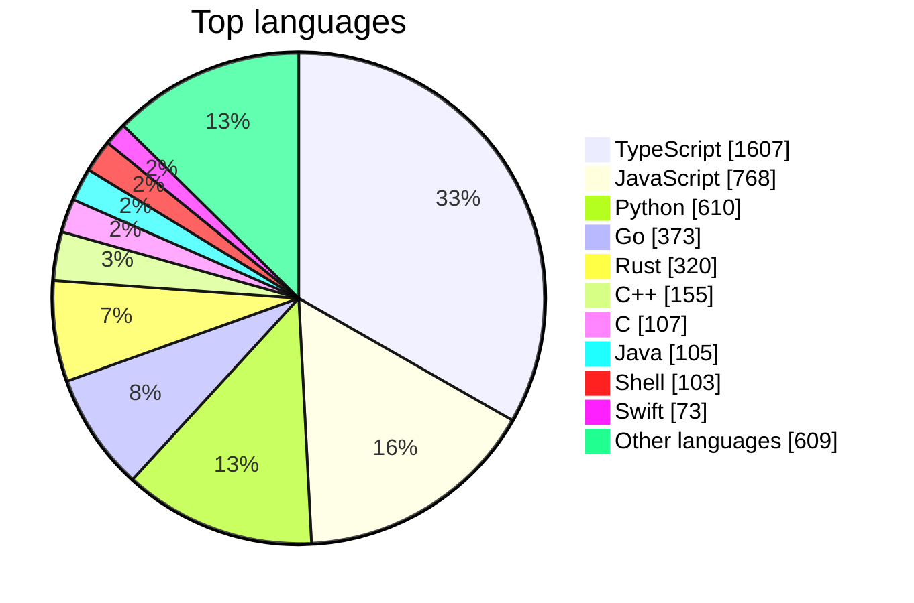
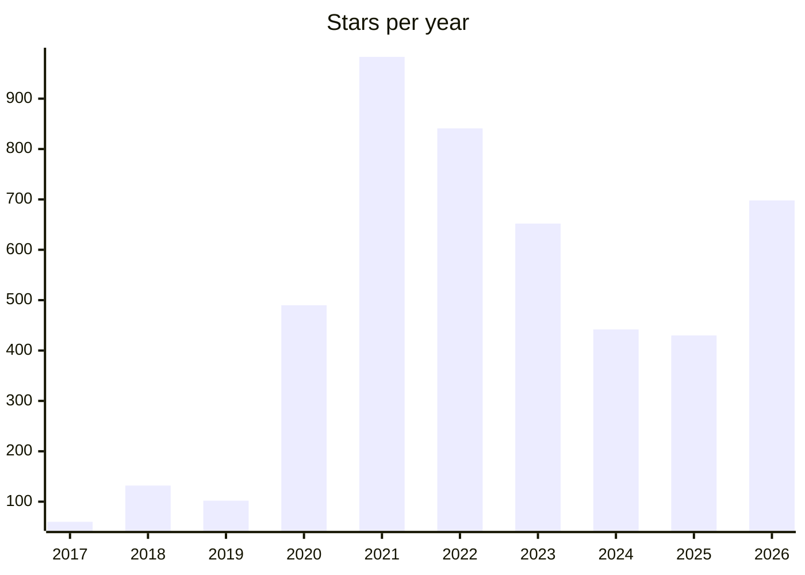

# Awesome Stars

> My GitHub stars, sorted and rebuilt every day by [starsmith](https://github.com/maxgfr/starsmith). Want the same for your stars? It takes one GitHub Action.

 

**[🔎 Search all 4,830 stars](https://maxgfr.github.io/awesome-stars/)**

## ✨ Digest

Agents dominate this month's stars. **Agent protocols and frontends** lead, with A2A and AG-UI bringing agents into apps, while **coding-agent tooling** gets practical: claude-swap rotates accounts, TokenEconomizer controls costs, and free-claude-code stretches free tokens. Many projects also favor **local-first native apps**, like hex for offline dictation.

Elsewhere, OCR keeps rising with chandra and GLM-OCR, and trading agents like Vibe-Trading show AI spreading into finance.

<sub>Written by AI from the 81 repositories starred in the last 30 days.</sub>

## 🆕 Recently starred

- `2026-11-12` [GoogleChrome/modern-web-guidance](https://github.com/GoogleChrome/modern-web-guidance) — Guidance on current web development best practices, provided for use by coding agents.
- `2026-11-10` [ag-ui-protocol/ag-ui](https://github.com/ag-ui-protocol/ag-ui) — Protocol for connecting AI agents to frontend applications, covering agent-user interaction.
- `2026-11-10` [a2aproject/A2A](https://github.com/a2aproject/A2A) — Open protocol for communication and interoperability between opaque agentic applications.
- `2026-11-10` [open-slide/open-slide](https://github.com/open-slide/open-slide) — Slide framework designed for AI agents to build presentations, built with React.
- `2026-11-10` [milind-soni/OpenMausBot](https://github.com/milind-soni/OpenMausBot) — Open-source alternative to Grok Bot, with a virtual machine that bots can use for computer tasks.
- `2026-11-09` [DrWhax/unfairplay](https://github.com/DrWhax/unfairplay) — Tool for decrypting iOS IPA files on macOS.
- `2026-11-09` [mflux-community/mflux](https://github.com/mflux-community/mflux) — Apple MLX implementations of image and video generation models such as FLUX, for Apple silicon.
- `2026-11-09` [ciromattia/kcc](https://github.com/ciromattia/kcc) — Converter that turns comic and manga archives into ebook formats for Kindle and other e-readers.
- `2026-11-08` [liabru/matter-js](https://github.com/liabru/matter-js) — 2D rigid body physics engine for the web, for use in JavaScript and canvas applications.
- `2026-11-08` [jhlywa/chess.js](https://github.com/jhlywa/chess.js) — TypeScript library for chess move generation, validation, and check, checkmate, and draw detection.
- `2026-11-08` [anomalyco/rune](https://github.com/anomalyco/rune) — Native user interface framework written in Rust.
- `2026-11-07` [anomalyco/hex](https://github.com/anomalyco/hex) — Local voice dictation app for macOS, Windows, and Linux that runs speech recognition on-device.
- `2026-11-06` [unjs/uqr](https://github.com/unjs/uqr) — Universal QR code generator for any JavaScript runtime, with ANSI, Unicode, and SVG output.
- `2026-11-06` [matomo-org/plugin-McpServer](https://github.com/matomo-org/plugin-McpServer)
- `2026-11-06` [Tencent/WeKnora](https://github.com/Tencent/WeKnora) — LLM platform that turns documents into queryable RAG, reasoning agents, and self-maintaining wikis.

## 📊 Stats

**4830** repositories · **76** languages · **51** archived · starred since 2017-02-02





## Contents

- [AI and Machine Learning (241)](stars/ai-and-machine-learning.md)
- [Audio and Video Processing (119)](stars/audio-and-video-processing.md)
- [Awesome Lists and Learning Resources (175)](stars/awesome-lists-and-learning-resources.md)
- [Backend Frameworks and Servers (219)](stars/backend-frameworks-and-servers.md)
- [Browser Extensions and Scripts (74)](stars/browser-extensions-and-scripts.md)
- [Cloud and Kubernetes (161)](stars/cloud-and-kubernetes.md)
- [Cryptography and Blockchain (157)](stars/cryptography-and-blockchain.md)
- [Databases and Data Tools (251)](stars/databases-and-data-tools.md)
- [Desktop and Mobile Apps (238)](stars/desktop-and-mobile-apps.md)
- [Developer Tools and Editors (328)](stars/developer-tools-and-editors.md)
- [DevOps and Infrastructure (263)](stars/devops-and-infrastructure.md)
- [Documentation and Knowledge Tools (145)](stars/documentation-and-knowledge-tools.md)
- [Frontend UI Libraries (553)](stars/frontend-ui-libraries.md)
- [Image and Graphics Processing (82)](stars/image-and-graphics-processing.md)
- [JavaScript and TypeScript Tooling (528)](stars/javascript-and-typescript-tooling.md)
- [LLM Agents and AI Assistants (327)](stars/llm-agents-and-ai-assistants.md)
- [Mac Utilities (67)](stars/mac-utilities.md)
- [Networking and Wireless (104)](stars/networking-and-wireless.md)
- [Programming Languages and Compilers (49)](stars/programming-languages-and-compilers.md)
- [Security and Penetration Testing (242)](stars/security-and-penetration-testing.md)
- [Systems Programming in Go and Rust (41)](stars/systems-programming-in-go-and-rust.md)
- [Testing and Automation (110)](stars/testing-and-automation.md)
- [Others (356)](stars/others.md)

## AI and Machine Learning

| Name | Description | Author | Stars |
|---|---|---|---:|
| [tensorflow](https://github.com/tensorflow/tensorflow) | Open source machine learning framework for building and training distributed deep neural networks. | tensorflow | 202k |
| [ollama](https://github.com/ollama/ollama) | Tool for running open large language models such as DeepSeek, Gemma, GLM, and Qwen locally. | ollama | 187k |
| [transformers](https://github.com/huggingface/transformers) | Python framework providing model definitions for machine learning models across text, vision, audio, and multimodal tasks. | huggingface | 169k |
| [ComfyUI](https://github.com/Comfy-Org/ComfyUI) | Node-based graph interface and backend for running diffusion models locally. | Comfy-Org | 146k |
| [llama.cpp](https://github.com/ggml-org/llama.cpp) | C/C++ inference of large language models using the ggml tensor library. | ggml-org | 134k |

**[→ All 241 repositories](stars/ai-and-machine-learning.md)**

## Audio and Video Processing

| Name | Description | Author | Stars |
|---|---|---|---:|
| [yt-dlp](https://github.com/yt-dlp/yt-dlp) | Command-line tool for downloading audio and video from YouTube and many other sites. | yt-dlp | 207k |
| [scrcpy](https://github.com/Genymobile/scrcpy) | Command-line tool to display and control Android devices from a computer over USB or TCP/IP. | Genymobile | 155k |
| [iptv](https://github.com/iptv-org/iptv) | Collection of publicly available IPTV channel playlists from around the world. | iptv-org | 144k |
| [youtube-dl](https://github.com/ytdl-org/youtube-dl) | Command-line program for downloading videos from YouTube.com and other video sites. | ytdl-org | 142k |
| [VoiceStudio](https://github.com/debpalash/VoiceStudio) | Local voice cloning, dubbing, dictation, transcription, and audiobook creation in 646 languages. | debpalash | 109k |

**[→ All 119 repositories](stars/audio-and-video-processing.md)**

## Awesome Lists and Learning Resources

| Name | Description | Author | Stars |
|---|---|---|---:|
| [build-your-own-x](https://github.com/codecrafters-io/build-your-own-x) | Curated list of tutorials for recreating well-known technologies from scratch. | codecrafters-io | 562k |
| [awesome](https://github.com/sindresorhus/awesome) | Curated index of other awesome lists organized by topic, with guidelines for creating them. | sindresorhus | 536k |
| [public-apis](https://github.com/public-apis/public-apis) | Community-maintained list of free public APIs across many categories for developers. | public-apis | 498k |
| [free-programming-books](https://github.com/EbookFoundation/free-programming-books) | Curated list of freely available programming books and learning resources in many languages. | EbookFoundation | 401k |
| [system-design-primer](https://github.com/donnemartin/system-design-primer) | Guide to designing large-scale systems, with study material for system design interviews. | donnemartin | 378k |

**[→ All 175 repositories](stars/awesome-lists-and-learning-resources.md)**

## Backend Frameworks and Servers

| Name | Description | Author | Stars |
|---|---|---|---:|
| [node](https://github.com/nodejs/node) | JavaScript runtime built on V8 for running server-side and command-line JavaScript applications. | nodejs | 123k |
| [fastapi](https://github.com/fastapi/fastapi) | Python web framework for building high-performance APIs with type hints and asyncio support. | fastapi | 105k |
| [gin](https://github.com/gin-gonic/gin) | High-performance HTTP web framework for Go, with a Martini-like API and router middleware. | gin-gonic | 89.5k |
| [laravel](https://github.com/laravel/laravel) | Laravel is a web application framework with expressive, elegant syntax. We’ve already laid the foundation for your next big idea — freeing you to create without sweating the small things. | laravel | 85.4k |
| [caddy](https://github.com/caddyserver/caddy) | Extensible HTTP/1, HTTP/2 and HTTP/3 web server written in Go with automatic HTTPS. | caddyserver | 79k |

**[→ All 219 repositories](stars/backend-frameworks-and-servers.md)**

## Browser Extensions and Scripts

| Name | Description | Author | Stars |
|---|---|---|---:|
| [uBlock](https://github.com/gorhill/uBlock) | Browser extension that blocks ads and trackers in Chromium and Firefox, with low resource use. | gorhill | 69.3k |
| [markdown-here](https://github.com/adam-p/markdown-here) | Google Chrome, Firefox, and Thunderbird extension that lets you write email in Markdown and render it before sending. | adam-p | 60.3k |
| [obscura](https://github.com/h4ckf0r0day/obscura) | Headless browser built for AI agents and web scraping, with anti-detection features. | h4ckf0r0day | 33.2k |
| [refined-github](https://github.com/refined-github/refined-github) | Browser extension that simplifies the GitHub interface and adds useful extra features. | refined-github | 32.5k |
| [vimium](https://github.com/philc/vimium) | Browser extension providing Vim-style keyboard navigation and control for web pages. | philc | 27.1k |

**[→ All 74 repositories](stars/browser-extensions-and-scripts.md)**

## Cloud and Kubernetes

| Name | Description | Author | Stars |
|---|---|---|---:|
| [kubernetes](https://github.com/kubernetes/kubernetes) | Production-Grade Container Scheduling and Management | kubernetes | 129k |
| [moby](https://github.com/moby/moby) | Open framework for assembling container-based systems, underlying the Docker container platform. | moby | 72.3k |
| [rclone](https://github.com/rclone/rclone) | Command-line tool for syncing and managing files across many cloud storage providers, like rsync. | rclone | 61k |
| [kubernetes-the-hard-way](https://github.com/kelseyhightower/kubernetes-the-hard-way) | Guide to bootstrapping a Kubernetes cluster manually, step by step without scripts. | kelseyhightower | 50.7k |
| [serverless](https://github.com/serverless/serverless) | Framework for building auto-scaling serverless applications on AWS Lambda and other cloud services. | serverless | 46.9k |

**[→ All 161 repositories](stars/cloud-and-kubernetes.md)**

## Cryptography and Blockchain

| Name | Description | Author | Stars |
|---|---|---|---:|
| [bitcoin](https://github.com/bitcoin/bitcoin) | Bitcoin Core integration/staging tree | bitcoin | 90.7k |
| [freqtrade](https://github.com/freqtrade/freqtrade) | Free, open-source Python bot for automated cryptocurrency trading and backtesting. | freqtrade | 56.8k |
| [go-ethereum](https://github.com/ethereum/go-ethereum) | Go implementation of the Ethereum protocol | ethereum | 51.5k |
| [acme.sh](https://github.com/acmesh-official/acme.sh) | Pure Unix shell script ACME client for automating SSL/TLS certificate issuance and renewal. | acmesh-official | 48k |
| [ccxt](https://github.com/ccxt/ccxt) | A unified trading API with more than 100 crypto exchanges and prediction markets in JavaScript / TypeScript / Python / C# / PHP / Go / Java / Rust | ccxt | 44.9k |

**[→ All 157 repositories](stars/cryptography-and-blockchain.md)**

## Databases and Data Tools

| Name | Description | Author | Stars |
|---|---|---|---:|
| [supabase](https://github.com/supabase/supabase) | Open source platform built on Postgres, offering databases, authentication, storage, and AI tooling for apps. | supabase | 115k |
| [elasticsearch](https://github.com/elastic/elasticsearch) | Free and open source distributed, RESTful search and analytics engine. | elastic | 78.7k |
| [redis](https://github.com/redis/redis) | In-memory data structure store used as a cache, database, and vector query engine. | redis | 77.5k |
| [superset](https://github.com/apache/superset) | Apache Superset is a Data Visualization and Data Exploration Platform | apache | 75.5k |
| [nocodb](https://github.com/nocodb/nocodb) | Self-hostable alternative to Airtable that turns databases into spreadsheets with automatic REST APIs. | nocodb | 65.5k |

**[→ All 251 repositories](stars/databases-and-data-tools.md)**

## Desktop and Mobile Apps

| Name | Description | Author | Stars |
|---|---|---|---:|
| [flutter](https://github.com/flutter/flutter) | Open-source UI framework for building natively compiled mobile, web, and desktop apps from Dart. | flutter | 181k |
| [PowerToys](https://github.com/microsoft/PowerToys) | Windows utilities that boost productivity and customisation, including FancyZones and Color Picker. | microsoft | 141k |
| [rustdesk](https://github.com/rustdesk/rustdesk) | Open-source remote desktop application for self-hosting, as an alternative to TeamViewer. | rustdesk | 129k |
| [react-native](https://github.com/react/react-native) | A framework for building native applications using React | react | 127k |
| [electron](https://github.com/electron/electron) | :electron: Build cross-platform desktop apps with JavaScript, HTML, and CSS | electron | 124k |

**[→ All 238 repositories](stars/desktop-and-mobile-apps.md)**

## Developer Tools and Editors

| Name | Description | Author | Stars |
|---|---|---|---:|
| [n8n](https://github.com/n8n-io/n8n) | Fair-code workflow automation platform with native AI capabilities and 400+ integrations. | n8n-io | 210k |
| [vscode](https://github.com/microsoft/vscode) | Code editor built with Electron and TypeScript, developed by Microsoft. | microsoft | 195k |
| [ohmyzsh](https://github.com/ohmyzsh/ohmyzsh) | 🙃 A delightful community-driven (with 2,500+ contributors) framework for managing your zsh configuration. Includes 300+ optional plugins (rails, git, macOS, hub, docker, homebrew, node, php, python, etc), 140+ themes to spice up your morning, and an auto-update tool that makes it easy to keep up with the latest updates from the community. | ohmyzsh | 191k |
| [gitignore](https://github.com/github/gitignore) | Collection of .gitignore templates for excluding common files and directories from Git repositories. | github | 176k |
| [spec-kit](https://github.com/github/spec-kit) | Toolkit for spec-driven development and other processes with AI coding assistants. | github | 149k |

**[→ All 328 repositories](stars/developer-tools-and-editors.md)**

## DevOps and Infrastructure

| Name | Description | Author | Stars |
|---|---|---|---:|
| [uptime-kuma](https://github.com/louislam/uptime-kuma) | Self-hosted uptime monitoring tool with a responsive dashboard, commonly run in Docker. | louislam | 93.5k |
| [netdata](https://github.com/netdata/netdata) | Observability platform for full stack monitoring, alerting, and visualization, with AI-powered features. | netdata | 81.4k |
| [grafana](https://github.com/grafana/grafana) | Open source platform for visualizing metrics, logs, and traces from many data sources. | grafana | 77.9k |
| [act](https://github.com/nektos/act) | Command-line tool for running GitHub Actions workflows locally using Docker. | nektos | 72.7k |
| [ansible](https://github.com/ansible/ansible) | IT automation platform for deploying, configuring, and maintaining applications, systems, and networks. | ansible | 71.5k |

**[→ All 263 repositories](stars/devops-and-infrastructure.md)**

## Documentation and Knowledge Tools

| Name | Description | Author | Stars |
|---|---|---|---:|
| [markitdown](https://github.com/microsoft/markitdown) | Python tool that converts files and Office documents to Markdown. | microsoft | 195k |
| [javascript](https://github.com/airbnb/javascript) | Community style guide defining coding conventions for JavaScript, ES2015 and later. | airbnb | 148k |
| [mermaid](https://github.com/mermaid-js/mermaid) | Tool that generates diagrams such as flowcharts and sequence diagrams from Markdown-like text. | mermaid-js | 91.1k |
| [hugo](https://github.com/gohugoio/hugo) | Static site generator written in Go for building fast websites, blogs, and documentation. | gohugoio | 90.5k |
| [AppFlowy](https://github.com/AppFlowy-IO/AppFlowy) | Open source AI workspace for projects, wikis, and docs, as an alternative to Notion. | AppFlowy-IO | 78.8k |

**[→ All 145 repositories](stars/documentation-and-knowledge-tools.md)**

## Frontend UI Libraries

| Name | Description | Author | Stars |
|---|---|---|---:|
| [react](https://github.com/react/react) | JavaScript library for building web and native user interfaces. | react | 253k |
| [bootstrap](https://github.com/twbs/bootstrap) | The most popular HTML, CSS, and JavaScript framework for developing responsive, mobile first projects on the web. | twbs | 175k |
| [next.js](https://github.com/vercel/next.js) | React framework for building server-rendered and statically generated web applications. | vercel | 143k |
| [excalidraw](https://github.com/excalidraw/excalidraw) | Virtual whiteboard for creating hand-drawn style diagrams and sketches, with real-time collaboration. | excalidraw | 136k |
| [ui](https://github.com/shadcn-ui/ui) | Copyable, accessible UI components you customize and extend to build your own component library. | shadcn-ui | 128k |

**[→ All 553 repositories](stars/frontend-ui-libraries.md)**

## Image and Graphics Processing

| Name | Description | Author | Stars |
|---|---|---|---:|
| [immich](https://github.com/immich-app/immich) | Self-hosted photo and video management solution with mobile apps and automatic backup. | immich-app | 119k |
| [three.js](https://github.com/mrdoob/three.js) | JavaScript library for creating and rendering 3D graphics in web browsers. | mrdoob | 118k |
| [opencv](https://github.com/opencv/opencv) | Open source computer vision library with algorithms for image processing and deep learning. | opencv | 91.5k |
| [FiraCode](https://github.com/tonsky/FiraCode) | Free monospaced font for programming with ligatures for common code operators. | tonsky | 82.2k |
| [photocraft](https://github.com/storytold/photocraft) | Open-source photo editor written from scratch in pure Rust. | storytold | 78.9k |

**[→ All 82 repositories](stars/image-and-graphics-processing.md)**

## JavaScript and TypeScript Tooling

| Name | Description | Author | Stars |
|---|---|---|---:|
| [axios](https://github.com/axios/axios) | Promise based HTTP client for the browser and node.js | axios | 109k |
| [deno](https://github.com/denoland/deno) | Modern runtime for JavaScript and TypeScript built on V8 and Rust. | denoland | 109k |
| [bun](https://github.com/oven-sh/bun) | Fast JavaScript runtime with built-in bundler, test runner, and package manager. | oven-sh | 96.7k |
| [vite](https://github.com/vitejs/vite) | Frontend build tool with a fast dev server and hot module replacement. | vitejs | 83.9k |
| [webpack](https://github.com/webpack/webpack) | Module bundler that packs JavaScript and other assets into bundles, with code splitting and loaders. | webpack | 66k |

**[→ All 528 repositories](stars/javascript-and-typescript-tooling.md)**

## LLM Agents and AI Assistants

| Name | Description | Author | Stars |
|---|---|---|---:|
| [openclaw](https://github.com/openclaw/openclaw) | Personal AI assistant that carries out tasks on any operating system and messaging platform. | openclaw | 394k |
| [skills](https://github.com/mattpocock/skills) | Collection of agent skills for software engineers, taken from the author's .agents directory. | mattpocock | 323k |
| [superpowers](https://github.com/obra/superpowers) | Skills framework and software development methodology for AI coding agents. | obra | 317k |
| [ECC](https://github.com/affaan-m/ECC) | Agent harness of skills, memory and security tools for Claude Code, Codex, Cursor and others. | affaan-m | 302k |
| [deepseek-harness](https://github.com/deepseek-ai/deepseek-harness) | Plugin-based agent harness for DeepSeek, built on Cordis, where everything is a plugin. | deepseek-ai | 280k |

**[→ All 327 repositories](stars/llm-agents-and-ai-assistants.md)**

## Mac Utilities

| Name | Description | Author | Stars |
|---|---|---|---:|
| [awesome-mac](https://github.com/jaywcjlove/awesome-mac) | Curated collection of high-quality macOS software organized by category for easy discovery. | jaywcjlove | 118k |
| [Mole](https://github.com/tw93/Mole) | Open-source Mac and PC cleaner CLI that frees disk space and analyzes storage use. | tw93 | 74.8k |
| [open-source-mac-os-apps](https://github.com/serhii-londar/open-source-mac-os-apps) | Curated list of open source applications for macOS. | serhii-londar | 51.3k |
| [brew](https://github.com/Homebrew/brew) | Command-line package manager for installing and managing software on macOS and Linux. | Homebrew | 50.3k |
| [stats](https://github.com/exelban/stats) | macOS system monitor showing CPU, memory, disk, network, battery and fan stats in the menu bar. | exelban | 43.3k |

**[→ All 67 repositories](stars/mac-utilities.md)**

## Networking and Wireless

| Name | Description | Author | Stars |
|---|---|---|---:|
| [frp](https://github.com/fatedier/frp) | Fast reverse proxy that exposes a local server behind a NAT or firewall to the internet. | fatedier | 111k |
| [syncthing](https://github.com/syncthing/syncthing) | Open source continuous file synchronization tool that works peer to peer between devices. | syncthing | 90.4k |
| [pi-hole](https://github.com/pi-hole/pi-hole) | Network-wide DNS sinkhole that blocks Internet advertisements, with a web dashboard and DHCP server. | pi-hole | 61.9k |
| [copyparty](https://github.com/9001/copyparty) | Single-file portable file server with resumable uploads, deduplication, WebDAV, SFTP, FTP, and media indexing. | 9001 | 47.3k |
| [okhttp](https://github.com/lysine-dev/okhttp) | HTTP client for the JVM, Android, and GraalVM. | lysine-dev | 47.1k |

**[→ All 104 repositories](stars/networking-and-wireless.md)**

## Programming Languages and Compilers

| Name | Description | Author | Stars |
|---|---|---|---:|
| [go](https://github.com/golang/go) | Source code for the Go programming language, including its compiler, tools, and standard library. | golang | 140k |
| [rust](https://github.com/rust-lang/rust) | Source code for the Rust programming language, including its compiler and standard library. | rust-lang | 122k |
| [TypeScript](https://github.com/microsoft/TypeScript) | Typed superset of JavaScript that compiles to plain JavaScript, with a static type checker. | microsoft | 112k |
| [java-design-patterns](https://github.com/iluwatar/java-design-patterns) | Collection of design patterns implemented in Java, with explanations and code snippets. | iluwatar | 94.9k |
| [cpython](https://github.com/python/cpython) | Reference implementation of the Python programming language and its standard library. | python | 78.2k |

**[→ All 49 repositories](stars/programming-languages-and-compilers.md)**

## Security and Penetration Testing

| Name | Description | Author | Stars |
|---|---|---|---:|
| [rea](https://github.com/morluto/rea) | Agent-based tool for reverse engineering applications, from app behavior down to native binaries. | morluto | 454k |
| [Microsoft-Activation-Scripts](https://github.com/massgravel/Microsoft-Activation-Scripts) | Open-source script for activating Windows and Office using HWID, Ohook, TSforge and KMS methods. | massgravel | 199k |
| [sherlock](https://github.com/sherlock-project/sherlock) | Command-line tool that searches for a username across many social networks to find matching accounts. | sherlock-project | 110k |
| [ghidra](https://github.com/NationalSecurityAgency/ghidra) | Software reverse engineering framework for disassembly, decompilation, and software analysis. | NationalSecurityAgency | 99.7k |
| [PayloadsAllTheThings](https://github.com/swisskyrepo/PayloadsAllTheThings) | Reference list of payloads, bypass techniques, and cheatsheets for web application security testing. | swisskyrepo | 82.6k |

**[→ All 242 repositories](stars/security-and-penetration-testing.md)**

## Systems Programming in Go and Rust

| Name | Description | Author | Stars |
|---|---|---|---:|
| [croc](https://github.com/schollz/croc) | Command-line tool for securely sending files and folders between computers with peer-to-peer transfer. | schollz | 40.9k |
| [tokio](https://github.com/tokio-rs/tokio) | Asynchronous runtime for Rust, providing I/O, networking, scheduling, and timers. | tokio-rs | 33.7k |
| [iced](https://github.com/iced-rs/iced) | Cross-platform, renderer-agnostic GUI library for Rust, inspired by Elm. | iced-rs | 32k |
| [nautilus_trader](https://github.com/nautechsystems/nautilus_trader) | Rust-native algorithmic trading engine with a deterministic event-driven architecture for production use. | nautechsystems | 31.5k |
| [zstd](https://github.com/meta/zstd) | Fast real-time lossless compression algorithm and reference library. | meta | 28.2k |

**[→ All 41 repositories](stars/systems-programming-in-go-and-rust.md)**

## Testing and Automation

| Name | Description | Author | Stars |
|---|---|---|---:|
| [Scrapling](https://github.com/D4Vinci/Scrapling) | Web scraping framework for everything from single requests to full-scale crawls. | D4Vinci | 102k |
| [playwright](https://github.com/microsoft/playwright) | Framework for web testing and automation across Chromium, Firefox and WebKit with a single API. | microsoft | 100k |
| [puppeteer](https://github.com/puppeteer/puppeteer) | JavaScript API for controlling Chrome and Firefox, mainly for browser automation and headless testing. | puppeteer | 95.8k |
| [cypress](https://github.com/cypress-io/cypress) | End-to-end and component testing framework for applications running in a browser. | cypress-io | 51k |
| [jest](https://github.com/jestjs/jest) | JavaScript testing framework focused on simplicity, with built-in mocking and assertions. | jestjs | 45.5k |

**[→ All 110 repositories](stars/testing-and-automation.md)**

## Others

| Name | Description | Author | Stars |
|---|---|---|---:|
| [linux](https://github.com/torvalds/linux) | Source tree of the Linux kernel, an open-source operating system kernel. | torvalds | 255k |
| [godot](https://github.com/godotengine/godot) | Open-source multi-platform engine for building 2D and 3D games. | godotengine | 120k |
| [Stirling-PDF](https://github.com/Stirling-Tools/Stirling-PDF) | Web application for editing, converting and processing PDF files, self-hosted via Docker. | Stirling-Tools | 96.4k |
| [core](https://github.com/home-assistant/core) | Open source home automation platform focused on local control and privacy for IoT devices. | home-assistant | 92.3k |
| [realworld](https://github.com/realworld-apps/realworld) | Fullstack demo application implementing the same Medium.com-style blog across many frontend and backend stacks. | realworld-apps | 84.4k |

**[→ All 356 repositories](stars/others.md)**

**Legend:** 🗄️ archived · 🆕 starred in the last 30 days

## ⭐ Make your own

This list is built by [starsmith](https://github.com/maxgfr/starsmith). To get yours, add this
workflow to any repository, then run it once from the Actions tab:

```yaml
# .github/workflows/stars.yml
name: Update stars
on:
  schedule:
    - cron: "30 18 * * *"
  workflow_dispatch:
permissions:
  contents: write
jobs:
  stars:
    runs-on: ubuntu-latest
    steps:
      - uses: actions/checkout@v7
      - uses: maxgfr/starsmith@v1
```

For AI categories, descriptions and a digest, add `group-by: ai-category`, `ai: true`,
`ai-provider` and an `ai-api-key` secret. Every option is in the
[starsmith README](https://github.com/maxgfr/starsmith#options).

<sub>Generated by [starsmith](https://github.com/maxgfr/starsmith) · 2026-11-12</sub>
