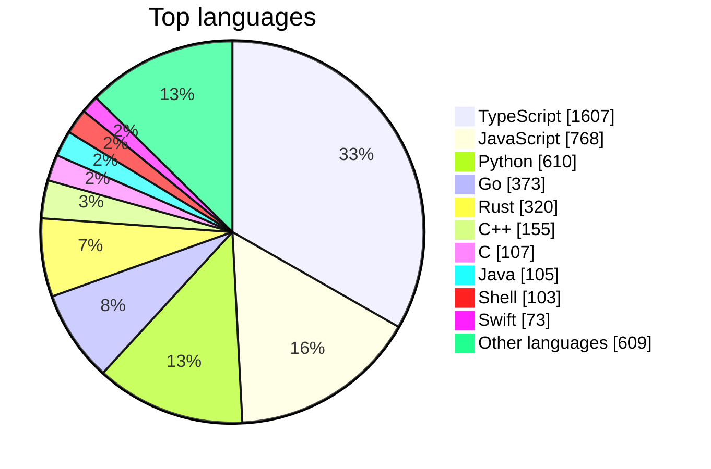
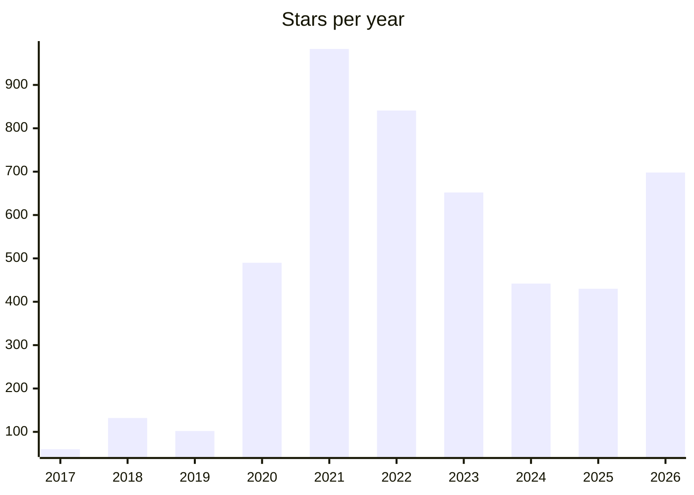

# Awesome Stars

> My GitHub stars, sorted and rebuilt every day by [starsmith](https://github.com/maxgfr/starsmith). Want the same for your stars? It takes one GitHub Action.

 

## ✨ Digest

Agents dominate this month's stars. **Agent protocols and frontends** lead, with A2A and AG-UI bringing agents into apps, while **coding-agent tooling** gets practical: claude-swap rotates accounts, TokenEconomizer controls costs, and free-claude-code stretches free tokens. Many projects also favor **local-first native apps**, like hex for offline dictation.

Elsewhere, OCR keeps rising with chandra and GLM-OCR, and trading agents like Vibe-Trading show AI spreading into finance.

<sub>Written by AI from the 81 repositories starred in the last 30 days.</sub>

## 🆕 Recently starred

- `2026-11-12` [GoogleChrome/modern-web-guidance](https://github.com/GoogleChrome/modern-web-guidance) — Guidance on current web development best practices, provided for use by coding agents.
- `2026-11-10` [ag-ui-protocol/ag-ui](https://github.com/ag-ui-protocol/ag-ui) — Protocol for connecting AI agents to frontend applications, covering agent-user interaction.
- `2026-11-10` [a2aproject/A2A](https://github.com/a2aproject/A2A) — Open protocol for communication and interoperability between opaque agentic applications.
- `2026-11-10` [open-slide/open-slide](https://github.com/open-slide/open-slide) — Slide framework designed for AI agents to build presentations, built with React.
- `2026-11-10` [milind-soni/OpenMausBot](https://github.com/milind-soni/OpenMausBot) — Open-source alternative to Grok Bot, with a virtual machine that bots can use for computer tasks.
- `2026-11-09` [DrWhax/unfairplay](https://github.com/DrWhax/unfairplay) — Tool for decrypting iOS IPA files on macOS.
- `2026-11-09` [mflux-community/mflux](https://github.com/mflux-community/mflux) — Apple MLX implementations of image and video generation models such as FLUX, for Apple silicon.
- `2026-11-09` [ciromattia/kcc](https://github.com/ciromattia/kcc) — Converter that turns comic and manga archives into ebook formats for Kindle and other e-readers.
- `2026-11-08` [liabru/matter-js](https://github.com/liabru/matter-js) — 2D rigid body physics engine for the web, for use in JavaScript and canvas applications.
- `2026-11-08` [jhlywa/chess.js](https://github.com/jhlywa/chess.js) — TypeScript library for chess move generation, validation, and check, checkmate, and draw detection.
- `2026-11-08` [anomalyco/rune](https://github.com/anomalyco/rune) — Native user interface framework written in Rust.
- `2026-11-07` [anomalyco/hex](https://github.com/anomalyco/hex) — Local voice dictation app for macOS, Windows, and Linux that runs speech recognition on-device.
- `2026-11-06` [unjs/uqr](https://github.com/unjs/uqr) — Universal QR code generator for any JavaScript runtime, with ANSI, Unicode, and SVG output.
- `2026-11-06` [matomo-org/plugin-McpServer](https://github.com/matomo-org/plugin-McpServer)
- `2026-11-06` [Tencent/WeKnora](https://github.com/Tencent/WeKnora) — LLM platform that turns documents into queryable RAG, reasoning agents, and self-maintaining wikis.

## 📊 Stats

**4830** repositories · **76** languages · **51** archived · starred since 2017-02-02





## Contents

- [Adblock Filter List (1)](stars/adblock-filter-list.md)
- [Astro (3)](stars/astro.md)
- [AutoIt (2)](stars/autoit.md)
- [Batchfile (2)](stars/batchfile.md)
- [Bicep (1)](stars/bicep.md)
- [Bikeshed (2)](stars/bikeshed.md)
- [Blade (2)](stars/blade.md)
- [C (107)](stars/c.md)
- [C# (35)](stars/c-sharp.md)
- [C++ (155)](stars/c-plus-plus.md)
- [Clojure (5)](stars/clojure.md)
- [CodeQL (1)](stars/codeql.md)
- [Crystal (1)](stars/crystal.md)
- [CSS (16)](stars/css.md)
- [Cython (1)](stars/cython.md)
- [D (2)](stars/d.md)
- [Dart (16)](stars/dart.md)
- [Dhall (1)](stars/dhall.md)
- [Dockerfile (8)](stars/dockerfile.md)
- [EJS (1)](stars/ejs.md)
- [Elixir (3)](stars/elixir.md)
- [Elm (1)](stars/elm.md)
- [Erlang (2)](stars/erlang.md)
- [Go (373)](stars/go.md)
- [Go Template (6)](stars/go-template.md)
- [Groovy (2)](stars/groovy.md)
- [Haskell (5)](stars/haskell.md)
- [HTML (61)](stars/html.md)
- [Java (105)](stars/java.md)
- [JavaScript (768)](stars/javascript.md)
- [Jinja (2)](stars/jinja.md)
- [JSON (1)](stars/json.md)
- [Jupyter Notebook (25)](stars/jupyter-notebook.md)
- [Kotlin (35)](stars/kotlin.md)
- [Lean (1)](stars/lean.md)
- [LLVM (1)](stars/llvm.md)
- [Lua (9)](stars/lua.md)
- [Makefile (3)](stars/makefile.md)
- [Markdown (11)](stars/markdown.md)
- [MDX (11)](stars/mdx.md)
- [Meson (1)](stars/meson.md)
- [Mojo (1)](stars/mojo.md)
- [Mustache (1)](stars/mustache.md)
- [Nim (1)](stars/nim.md)
- [Nix (1)](stars/nix.md)
- [Nunjucks (1)](stars/nunjucks.md)
- [Nushell (1)](stars/nushell.md)
- [Objective-C (10)](stars/objective-c.md)
- [Objective-C++ (3)](stars/objective-c-plus-plus.md)
- [OCaml (2)](stars/ocaml.md)
- [Pascal (1)](stars/pascal.md)
- [PEG.js (1)](stars/peg-js.md)
- [Perl (3)](stars/perl.md)
- [PHP (58)](stars/php.md)
- [PLpgSQL (3)](stars/plpgsql.md)
- [PowerShell (7)](stars/powershell.md)
- [Pug (1)](stars/pug.md)
- [Python (610)](stars/python.md)
- [R (4)](stars/r.md)
- [ReScript (1)](stars/rescript.md)
- [reStructuredText (1)](stars/restructuredtext.md)
- [Ruby (40)](stars/ruby.md)
- [Rust (320)](stars/rust.md)
- [Scala (4)](stars/scala.md)
- [SCSS (5)](stars/scss.md)
- [Shell (103)](stars/shell.md)
- [Solidity (1)](stars/solidity.md)
- [Starlark (2)](stars/starlark.md)
- [Svelte (4)](stars/svelte.md)
- [Swift (73)](stars/swift.md)
- [TeX (1)](stars/tex.md)
- [TypeScript (1607)](stars/typescript.md)
- [Vim Script (3)](stars/vim-script.md)
- [Vue (13)](stars/vue.md)
- [WebAssembly (1)](stars/webassembly.md)
- [Zig (6)](stars/zig.md)
- [Others (148)](stars/others.md)

## Adblock Filter List

| Name | Description | Author | Stars |
|---|---|---|---:|
| [uAssets](https://github.com/uBlockOrigin/uAssets) | Filter lists for uBlock Origin and uBlock Origin Lite content blocking. | uBlockOrigin | 6.1k |

**[→ All 1 repositories](stars/adblock-filter-list.md)**

## Astro

| Name | Description | Author | Stars |
|---|---|---|---:|
| [AdminLTE](https://github.com/ColorlibHQ/AdminLTE) | AdminLTE - Free admin dashboard template based on Bootstrap 5 | ColorlibHQ | 45.7k |
| [hyperui](https://github.com/markmead/hyperui) | Free Tailwind CSS v4 component library for building accessible web interfaces. | markmead | 12.3k |
| [devportfolio](https://github.com/RyanFitzgerald/devportfolio) | A modern, minimalist portfolio template built with Astro and Tailwind CSS. Perfect for developers looking to showcase their skills, experience, and projects in a clean, professional way. | RyanFitzgerald | 5k |

**[→ All 3 repositories](stars/astro.md)**

## AutoIt

| Name | Description | Author | Stars |
|---|---|---|---:|
| [MSEdgeRedirect](https://github.com/rcmaehl/MSEdgeRedirect) | Tool that redirects Microsoft Edge news, search, widget and weather links to the default browser. | rcmaehl | 5.9k |
| [GenP](https://github.com/TheMythologist/GenP) | Automatically builds GenP patcher executables for Adobe Creative Cloud from source. | TheMythologist | 4.7k |

**[→ All 2 repositories](stars/autoit.md)**

## Batchfile

| Name | Description | Author | Stars |
|---|---|---|---:|
| [Microsoft-Activation-Scripts](https://github.com/massgravel/Microsoft-Activation-Scripts) | Open-source script for activating Windows and Office using HWID, Ohook, TSforge and KMS methods. | massgravel | 199k |
| [windows-arm](https://github.com/dockur/windows-arm) | Docker container that runs Windows for ARM hardware using virtualization. | dockur | 2.3k |

**[→ All 2 repositories](stars/batchfile.md)**

## Bicep

| Name | Description | Author | Stars |
|---|---|---|---:|
| [azure-quickstart-templates](https://github.com/Azure/azure-quickstart-templates) | Azure Quickstart Templates | Azure | 14.9k |

**[→ All 1 repositories](stars/bicep.md)**

## Bikeshed

| Name | Description | Author | Stars |
|---|---|---|---:|
| [ServiceWorker](https://github.com/w3c/ServiceWorker) | Service Workers | w3c | 3.6k |
| [webappsec-permissions-policy](https://github.com/w3c/webappsec-permissions-policy) | A mechanism to selectively enable and disable browser features and APIs | w3c | 432 |

**[→ All 2 repositories](stars/bikeshed.md)**

## Blade

| Name | Description | Author | Stars |
|---|---|---|---:|
| [laravel](https://github.com/laravel/laravel) | Laravel is a web application framework with expressive, elegant syntax. We’ve already laid the foundation for your next big idea — freeing you to create without sweating the small things. | laravel | 85.4k |
| [grocy](https://github.com/grocy/grocy) | Self-hosted web application for managing groceries, household stock, recipes and meal plans. | grocy | 9.7k |

**[→ All 2 repositories](stars/blade.md)**

## C

| Name | Description | Author | Stars |
|---|---|---|---:|
| [linux](https://github.com/torvalds/linux) | Linux kernel source tree | torvalds | 255k |
| [scrcpy](https://github.com/Genymobile/scrcpy) | Display and control your Android device | Genymobile | 155k |
| [PowerToys](https://github.com/microsoft/PowerToys) | Microsoft PowerToys is a collection of utilities that supercharge productivity and customization on Windows | microsoft | 141k |
| [Ventoy](https://github.com/ventoy/Ventoy) | A new bootable USB solution. | ventoy | 80.8k |
| [obs-studio](https://github.com/obsproject/obs-studio) | OBS Studio - Free and open source software for live streaming and screen recording | obsproject | 79.5k |

**[→ All 107 repositories](stars/c.md)**

## C#

| Name | Description | Author | Stars |
|---|---|---|---:|
| [jellyfin](https://github.com/jellyfin/jellyfin) | Free software media system server backend and API for organizing and streaming media libraries. | jellyfin | 59.3k |
| [PowerShell](https://github.com/PowerShell/PowerShell) | PowerShell for every system! | PowerShell | 56.1k |
| [Files](https://github.com/files-community/Files) | A modern file manager that helps users organize their files and folders. | files-community | 46.6k |
| [ShareX](https://github.com/ShareX/ShareX) | ShareX is a free and open-source application that enables users to capture or record any area of their screen with a single keystroke. It also supports uploading images, text, and various file types to a wide range of destinations. | ShareX | 41k |
| [calculator](https://github.com/microsoft/calculator) | Windows Calculator: A simple yet powerful calculator that ships with Windows | microsoft | 31.1k |

**[→ All 35 repositories](stars/c-sharp.md)**

## C++

| Name | Description | Author | Stars |
|---|---|---|---:|
| [tensorflow](https://github.com/tensorflow/tensorflow) | An Open Source Machine Learning Framework for Everyone | tensorflow | 202k |
| [llama.cpp](https://github.com/ggml-org/llama.cpp) | C/C++ inference of large language models using the ggml tensor library. | ggml-org | 134k |
| [react-native](https://github.com/react/react-native) | A framework for building native applications using React | react | 127k |
| [electron](https://github.com/electron/electron) | :electron: Build cross-platform desktop apps with JavaScript, HTML, and CSS | electron | 124k |
| [godot](https://github.com/godotengine/godot) | Godot Engine – Multi-platform 2D and 3D game engine | godotengine | 120k |

**[→ All 155 repositories](stars/c-plus-plus.md)**

## Clojure

| Name | Description | Author | Stars |
|---|---|---|---:|
| [FiraCode](https://github.com/tonsky/FiraCode) | Free monospaced font with programming ligatures | tonsky | 82.2k |
| [penpot](https://github.com/penpot/penpot) | Penpot: The open-source design platform for Product teams that need scalable collaboration. | penpot | 62.3k |
| [metabase](https://github.com/metabase/metabase) | The easy-to-use open source Business Intelligence and Embedded Analytics tool that lets everyone work with data :bar_chart: | metabase | 50.3k |
| [logseq](https://github.com/logseq/logseq) | Privacy-first open-source app for knowledge management and collaboration using linked notes. | logseq | 45.6k |
| [status-legacy](https://github.com/status-im/status-legacy) 🗄️ | a free (libre) open source, mobile OS for Ethereum | status-im | 4k |

**[→ All 5 repositories](stars/clojure.md)**

## CodeQL

| Name | Description | Author | Stars |
|---|---|---|---:|
| [codeql](https://github.com/github/codeql) | CodeQL: the libraries and queries that power security researchers around the world, as well as code scanning in GitHub Advanced Security | github | 10.3k |

**[→ All 1 repositories](stars/codeql.md)**

## Crystal

| Name | Description | Author | Stars |
|---|---|---|---:|
| [invidious](https://github.com/iv-org/invidious) | Invidious is an alternative front-end to YouTube | iv-org | 25.9k |

**[→ All 1 repositories](stars/crystal.md)**

## CSS

| Name | Description | Author | Stars |
|---|---|---|---:|
| [nerd-fonts](https://github.com/ryanoasis/nerd-fonts) | Iconic font aggregator, collection, &amp; patcher. 3,600+ icons, 50+ patched fonts: Hack, Source Code Pro, more. Glyph collections: Font Awesome, Material Design Icons, Octicons, &amp; more | ryanoasis | 65.2k |
| [hallmark](https://github.com/Nutlope/hallmark) | Design skill for Claude Code, Cursor, and Codex that avoids generic AI-style visual output. | Nutlope | 53.7k |
| [bulma](https://github.com/jgthms/bulma) | Modern CSS framework based on Flexbox | jgthms | 50k |
| [pico](https://github.com/picocss/pico) 🗄️ | Minimal CSS Framework for semantic HTML | picocss | 16.8k |
| [GitHub-Dark](https://github.com/StylishThemes/GitHub-Dark) | :octocat: Dark GitHub style with custom syntax themes for code, editors and notebooks | StylishThemes | 10k |

**[→ All 16 repositories](stars/css.md)**

## Cython

| Name | Description | Author | Stars |
|---|---|---|---:|
| [ta-lib-python](https://github.com/TA-Lib/ta-lib-python) | Python wrapper for the TA-Lib technical analysis library, providing indicators and pattern recognition. | TA-Lib | 12.4k |

**[→ All 1 repositories](stars/cython.md)**

## D

| Name | Description | Author | Stars |
|---|---|---|---:|
| [onedrive](https://github.com/abraunegg/onedrive) | OneDrive client for Linux that syncs files with Microsoft OneDrive and Office 365 accounts. | abraunegg | 13k |
| [Sideloader](https://github.com/Dadoum/Sideloader) | Open-source cross-platform iOS sideloader with a CLI, supporting Linux, macOS, and Windows. | Dadoum | 1.1k |

**[→ All 2 repositories](stars/d.md)**

## Dart

| Name | Description | Author | Stars |
|---|---|---|---:|
| [flutter](https://github.com/flutter/flutter) | Flutter makes it easy and fast to build beautiful apps for mobile and beyond | flutter | 181k |
| [localsend](https://github.com/localsend/localsend) | Open-source, cross-platform file sharing app that serves as an alternative to AirDrop. | localsend | 98.6k |
| [AppFlowy](https://github.com/AppFlowy-IO/AppFlowy) | Bring projects, wikis, and teams together with AI. AppFlowy is the AI collaborative workspace where you achieve more without losing control of your data. The leading open source Notion alternative. | AppFlowy-IO | 78.8k |
| [awesome-flutter](https://github.com/Solido/awesome-flutter) | An awesome list that curates the best Flutter libraries, tools, tutorials, articles and more. | Solido | 61.9k |
| [ente](https://github.com/ente/ente) | End-to-end encrypted cloud storage for photos, files and two-factor authentication codes. | ente | 30.1k |

**[→ All 16 repositories](stars/dart.md)**

## Dhall

| Name | Description | Author | Stars |
|---|---|---|---:|
| [dhall-lang](https://github.com/dhall-lang/dhall-lang) | Maintainable configuration files | dhall-lang | 4.5k |

**[→ All 1 repositories](stars/dhall.md)**

## Dockerfile

| Name | Description | Author | Stars |
|---|---|---|---:|
| [nodebestpractices](https://github.com/goldbergyoni/nodebestpractices) | ✅ The Node.js best practices list (July 2026) | goldbergyoni | 106k |
| [Self-Hosting-Guide](https://github.com/mikeroyal/Self-Hosting-Guide) | Curated guide to self-hosting applications, LLMs, VPNs, and automation on local or private servers. | mikeroyal | 23.5k |
| [vulhub](https://github.com/vulhub/vulhub) | Pre-Built Vulnerable Environments Based on Docker-Compose | vulhub | 21.5k |
| [laradock](https://github.com/laradock/laradock) | Full PHP development environment for Docker. Run Laravel, Symfony, CodeIgniter, Phalcon, WordPress, Drupal, Magento, Moodle, or any PHP project with 70+ pre-configured services: Nginx, Apache, PHP-FPM, MySQL, PostgreSQL, MongoDB, Redis, Elasticsearch &amp; more. | laradock | 12.7k |
| [docker-node](https://github.com/nodejs/docker-node) | Official Docker Image for Node.js :whale: :turtle: :rocket: | nodejs | 8.6k |

**[→ All 8 repositories](stars/dockerfile.md)**

## EJS

| Name | Description | Author | Stars |
|---|---|---|---:|
| [reference](https://github.com/Fechin/reference) | Collection of quick reference cheat sheets for developers covering tools such as bash and awk. | Fechin | 11k |

**[→ All 1 repositories](stars/ejs.md)**

## Elixir

| Name | Description | Author | Stars |
|---|---|---|---:|
| [analytics](https://github.com/plausible/analytics) | Open source, privacy-first web analytics. Lightweight, cookie-free Google Analytics alternative. Self-hosted or cloud. | plausible | 29.8k |
| [realtime](https://github.com/supabase/realtime) | Broadcast, Presence, and Postgres Changes via WebSockets | supabase | 7.7k |
| [keila](https://github.com/pentacent/keila) | Open-source tool for sending newsletters. | pentacent | 2.3k |

**[→ All 3 repositories](stars/elixir.md)**

## Elm

| Name | Description | Author | Stars |
|---|---|---|---:|
| [azimutt](https://github.com/azimuttapp/azimutt) | Tool to explore, document, and optimize database schemas through interactive diagrams. | azimuttapp | 2.2k |

**[→ All 1 repositories](stars/elm.md)**

## Erlang

| Name | Description | Author | Stars |
|---|---|---|---:|
| [couchdb](https://github.com/apache/couchdb) | Seamless multi-primary syncing database with an intuitive HTTP/JSON API, designed for reliability | apache | 7k |
| [ejabberd](https://github.com/processone/ejabberd) | Robust, Ubiquitous and Massively Scalable Messaging Platform (XMPP, MQTT, SIP Server) | processone | 6.8k |

**[→ All 2 repositories](stars/erlang.md)**

## Go

| Name | Description | Author | Stars |
|---|---|---|---:|
| [awesome-go](https://github.com/avelino/awesome-go) | A curated list of awesome Go frameworks, libraries and software | avelino | 193k |
| [ollama](https://github.com/ollama/ollama) | Tool for running open large language models such as DeepSeek, Gemma, GLM, and Qwen locally. | ollama | 187k |
| [go](https://github.com/golang/go) | The Go programming language | golang | 140k |
| [kubernetes](https://github.com/kubernetes/kubernetes) | Production-Grade Container Scheduling and Management | kubernetes | 129k |
| [caveman](https://github.com/JuliusBrussee/caveman) | Skill and proxy for coding agents that reduces token use by about 65% through terse output. | JuliusBrussee | 119k |

**[→ All 373 repositories](stars/go.md)**

## Go Template

| Name | Description | Author | Stars |
|---|---|---|---:|
| [charts](https://github.com/bitnami/charts) | Bitnami Helm Charts | bitnami | 10.4k |
| [traefik-helm-chart](https://github.com/traefik/traefik-helm-chart) | Traefik Proxy Helm Chart | traefik | 1.4k |
| [truecharts](https://github.com/trueforge-org/truecharts) | Community Helm chart repository providing charts for deploying applications on Kubernetes and k3s. | trueforge-org | 1.4k |
| [charts](https://github.com/IBM/charts) | The IBM/charts repository provides helm charts for IBM and Third Party middleware. | IBM | 311 |
| [jitsi-helm](https://github.com/jitsi-contrib/jitsi-helm) | A helm chart to deploy Jitsi to Kubernetes | jitsi-contrib | 203 |

**[→ All 6 repositories](stars/go-template.md)**

## Groovy

| Name | Description | Author | Stars |
|---|---|---|---:|
| [gradle](https://github.com/gradle/gradle) | Adaptable, fast automation for all | gradle | 18.9k |
| [openboxes](https://github.com/openboxes/openboxes) | OpenBoxes is a warehouse management system designed to manage inventory and track stock movements for healthcare facilities. | openboxes | 927 |

**[→ All 2 repositories](stars/groovy.md)**

## Haskell

| Name | Description | Author | Stars |
|---|---|---|---:|
| [pandoc](https://github.com/jgm/pandoc) | Universal markup converter | jgm | 46.9k |
| [shellcheck](https://github.com/koalaman/shellcheck) | ShellCheck, a static analysis tool for shell scripts | koalaman | 40.3k |
| [postgrest](https://github.com/PostgREST/postgrest) | REST API for any Postgres database | PostgREST | 27.8k |
| [simplex-chat](https://github.com/simplex-chat/simplex-chat) | SimpleX - the first messaging network operating without user identifiers of any kind - 100% private by design! iOS, Android and desktop apps 📱! | simplex-chat | 19.7k |
| [hadolint](https://github.com/hadolint/hadolint) | Dockerfile linter, validate inline bash, written in Haskell | hadolint | 12.5k |

**[→ All 5 repositories](stars/haskell.md)**

## HTML

| Name | Description | Author | Stars |
|---|---|---|---:|
| [computer-science](https://github.com/ossu/computer-science) | 🎓 Path to a free self-taught education in Computer Science! | ossu | 211k |
| [free-for-dev](https://github.com/ripienaar/free-for-dev) | A list of SaaS, PaaS and IaaS offerings that have free tiers of interest to devops and infradev | ripienaar | 143k |
| [diagram-design](https://github.com/cathrynlavery/diagram-design) | Agent skill producing editorial diagrams as self-contained HTML and SVG for coding agents. | cathrynlavery | 66.7k |
| [ToolJet](https://github.com/ToolJet/ToolJet) | Open-source foundation of ToolJet AI - the enterprise app generation platform for internal tools, dashboards, business applications, workflows and AI agents. Build visually, from a prompt, or from Claude Code, Codex and Cursor over MCP 🚀 | ToolJet | 41.2k |
| [manifesto](https://github.com/opentofu/manifesto) 🗄️ | Manifesto expressing concern over HashiCorp's Terraform license change and calling for an open-source license. | opentofu | 35.6k |

**[→ All 61 repositories](stars/html.md)**

## Java

| Name | Description | Author | Stars |
|---|---|---|---:|
| [ghidra](https://github.com/NationalSecurityAgency/ghidra) | Ghidra is a software reverse engineering (SRE) framework | NationalSecurityAgency | 99.7k |
| [java-design-patterns](https://github.com/iluwatar/java-design-patterns) | Design patterns implemented in Java | iluwatar | 94.9k |
| [elasticsearch](https://github.com/elastic/elasticsearch) | Free and Open Source, Distributed, RESTful Search Engine | elastic | 78.7k |
| [Java](https://github.com/TheAlgorithms/Java) | All Algorithms implemented in Java | TheAlgorithms | 67.2k |
| [termux-app](https://github.com/termux/termux-app) | Termux - a terminal emulator application for Android OS extendible by variety of packages. | termux | 64.7k |

**[→ All 105 repositories](stars/java.md)**

## JavaScript

| Name | Description | Author | Stars |
|---|---|---|---:|
| [ECC](https://github.com/affaan-m/ECC) | Agent harness of skills, memory and security tools for Claude Code, Codex, Cursor and others. | affaan-m | 302k |
| [react](https://github.com/react/react) | The library for web and native user interfaces. | react | 253k |
| [javascript-algorithms](https://github.com/trekhleb/javascript-algorithms) | 📝 Algorithms and data structures implemented in JavaScript with explanations and links to further readings | trekhleb | 197k |
| [ponytail](https://github.com/DietrichGebert/ponytail) | Agent skills that make AI coding agents write less code, favoring simple solutions over new code. | DietrichGebert | 189k |
| [javascript](https://github.com/airbnb/javascript) | JavaScript Style Guide | airbnb | 148k |

**[→ All 768 repositories](stars/javascript.md)**

## Jinja

| Name | Description | Author | Stars |
|---|---|---|---:|
| [kubespray](https://github.com/kubernetes-sigs/kubespray) | Deploy a Production Ready Kubernetes Cluster | kubernetes-sigs | 18.8k |
| [ansible-nas](https://github.com/davestephens/ansible-nas) | Build a full-featured home server or NAS replacement with an Ubuntu box and this playbook. | davestephens | 3.8k |

**[→ All 2 repositories](stars/jinja.md)**

## JSON

| Name | Description | Author | Stars |
|---|---|---|---:|
| [browser-compat-data](https://github.com/mdn/browser-compat-data) | Dataset of browser compatibility data for Web technologies, as displayed on MDN. | mdn | 5.8k |

**[→ All 1 repositories](stars/json.md)**

## Jupyter Notebook

| Name | Description | Author | Stars |
|---|---|---|---:|
| [LLMs-from-scratch](https://github.com/rasbt/LLMs-from-scratch) | Step-by-step PyTorch code for implementing and training a GPT-style LLM from scratch. | rasbt | 108k |
| [openai-cookbook](https://github.com/openai/openai-cookbook) | Examples and guides for using the OpenAI API, including ChatGPT and GPT-4. | openai | 77.1k |
| [claude-cookbooks](https://github.com/anthropics/claude-cookbooks) | Notebooks and recipes demonstrating effective ways to use Claude. | anthropics | 54.6k |
| [Made-With-ML](https://github.com/GokuMohandas/Made-With-ML) | Learn how to develop, deploy and iterate on production-grade ML applications. | GokuMohandas | 50k |
| [data-engineer-handbook](https://github.com/DataExpert-io/data-engineer-handbook) | Curated links to data engineering resources on Apache Spark, big data, SQL, and more. | DataExpert-io | 45.1k |

**[→ All 25 repositories](stars/jupyter-notebook.md)**

## Kotlin

| Name | Description | Author | Stars |
|---|---|---|---:|
| [Magisk](https://github.com/topjohnwu/Magisk) | The Magic Mask for Android | topjohnwu | 64k |
| [spotube](https://github.com/team-spotube/spotube) | Open-source music streaming client for desktop and mobile, built with Flutter. | team-spotube | 50.7k |
| [okhttp](https://github.com/lysine-dev/okhttp) | A meticulous HTTP client for the JVM, Android, and GraalVM. | lysine-dev | 47.1k |
| [architecture-samples](https://github.com/android/architecture-samples) | A collection of samples to discuss and showcase different architectural tools and patterns for Android apps. | android | 45.9k |
| [MPAndroidChart](https://github.com/PhilJay/MPAndroidChart) | A powerful 🚀 Android chart view / graph view library, supporting line- bar- pie- radar- bubble- and candlestick charts as well as scaling, panning and animations. | PhilJay | 38.2k |

**[→ All 35 repositories](stars/kotlin.md)**

## Lean

| Name | Description | Author | Stars |
|---|---|---|---:|
| [lean4](https://github.com/leanprover/lean4) | Programming language and interactive theorem prover for writing verified mathematics and software. | leanprover | 10k |

**[→ All 1 repositories](stars/lean.md)**

## LLVM

| Name | Description | Author | Stars |
|---|---|---|---:|
| [llvm-project](https://github.com/llvm/llvm-project) | The LLVM Project is a collection of modular and reusable compiler and toolchain technologies. | llvm | 41.4k |

**[→ All 1 repositories](stars/llvm.md)**

## Lua

| Name | Description | Author | Stars |
|---|---|---|---:|
| [kong](https://github.com/Kong/kong) | 🦍 The API and AI Gateway | Kong | 44.4k |
| [koreader](https://github.com/koreader/koreader) | Ebook reader application for e-ink and mobile devices supporting PDF, DjVu, EPUB, and other formats. | koreader | 31k |
| [NvChad](https://github.com/NvChad/NvChad) | Neovim framework with defaults and a UI for configuring and extending Neovim. | NvChad | 28.5k |
| [LazyVim](https://github.com/LazyVim/LazyVim) | Neovim configuration framework built on lazy.nvim for quick setup of a modern editor. | LazyVim | 27.8k |
| [telescope.nvim](https://github.com/nvim-telescope/telescope.nvim) | Extensible fuzzy finder for Neovim to find, filter, preview and pick files and other items. | nvim-telescope | 19.9k |

**[→ All 9 repositories](stars/lua.md)**

## Makefile

| Name | Description | Author | Stars |
|---|---|---|---:|
| [mindshub](https://github.com/mindsdb/mindshub) | Unified workspace for running open-source AI models and agents to complete tasks. | mindsdb | 39.9k |
| [buildroot](https://github.com/buildroot/buildroot) | Tool for building embedded Linux systems; this is an unofficial mirror, not the official repository. | buildroot | 3.7k |
| [luds](https://github.com/lnurl/luds) | Specifications for LNURL, a protocol for Lightning Network interactions. | lnurl | 673 |

**[→ All 3 repositories](stars/makefile.md)**

## Markdown

| Name | Description | Author | Stars |
|---|---|---|---:|
| [build-your-own-x](https://github.com/codecrafters-io/build-your-own-x) | Curated list of tutorials for recreating well-known technologies from scratch. | codecrafters-io | 562k |
| [tldr](https://github.com/tldr-pages/tldr) | Collaborative cheatsheets for console commands 📚. | tldr-pages | 64.2k |
| [OpenAPI-Specification](https://github.com/OAI/OpenAPI-Specification) | The OpenAPI Specification Repository | OAI | 31.3k |
| [upptime](https://github.com/upptime/upptime) | ⬆️ GitHub Actions uptime monitor &amp; status page by @AnandChowdhary | upptime | 17.2k |
| [content](https://github.com/mdn/content) | The official source for MDN Web Docs content. Home to over 14,000 pages of documentation about HTML, CSS, JS, HTTP, Web APIs, and more. | mdn | 11.1k |

**[→ All 11 repositories](stars/markdown.md)**

## MDX

| Name | Description | Author | Stars |
|---|---|---|---:|
| [prompts.chat](https://github.com/f/prompts.chat) | Platform for sharing, discovering and collecting AI prompts, self-hostable for organizations. | f | 177k |
| [bootstrap](https://github.com/twbs/bootstrap) | The most popular HTML, CSS, and JavaScript framework for developing responsive, mobile first projects on the web. | twbs | 175k |
| [Prompt-Engineering-Guide](https://github.com/dair-ai/Prompt-Engineering-Guide) | Guides, papers, lessons, and notebooks on prompt engineering, context engineering, RAG, and AI agents. | dair-ai | 80k |
| [react-native-elements](https://github.com/react-native-elements/react-native-elements) | Cross-Platform React Native UI Toolkit | react-native-elements | 25.9k |
| [magicui](https://github.com/magicuidesign/magicui) | Open-source library of animated React components and effects to copy into Tailwind CSS apps. | magicuidesign | 23.2k |

**[→ All 11 repositories](stars/mdx.md)**

## Meson

| Name | Description | Author | Stars |
|---|---|---|---:|
| [frida](https://github.com/frida/frida) | Main repo for hosting release binaries | frida | 22.8k |

**[→ All 1 repositories](stars/meson.md)**

## Mojo

| Name | Description | Author | Stars |
|---|---|---|---:|
| [modular](https://github.com/modular/modular) | Modular AI platform including the MAX inference framework and the Mojo programming language. | modular | 30.1k |

**[→ All 1 repositories](stars/mojo.md)**

## Mustache

| Name | Description | Author | Stars |
|---|---|---|---:|
| [swagger-codegen](https://github.com/swagger-api/swagger-codegen) | swagger-codegen contains a template-driven engine to generate documentation, API clients and server stubs in different languages by parsing your OpenAPI / Swagger definition. | swagger-api | 17.8k |

**[→ All 1 repositories](stars/mustache.md)**

## Nim

| Name | Description | Author | Stars |
|---|---|---|---:|
| [auto-editor](https://github.com/WyattBlue/auto-editor) | Command-line tool that automatically cuts silent or still sections out of video and audio files. | WyattBlue | 5.9k |

**[→ All 1 repositories](stars/nim.md)**

## Nix

| Name | Description | Author | Stars |
|---|---|---|---:|
| [nixpkgs](https://github.com/NixOS/nixpkgs) | Nix Packages collection &amp; NixOS | NixOS | 26.8k |

**[→ All 1 repositories](stars/nix.md)**

## Nunjucks

| Name | Description | Author | Stars |
|---|---|---|---:|
| [eleventy-dsfr](https://github.com/codegouvfr/eleventy-dsfr) | Template for building French government sites with the DSFR design system using Eleventy. | codegouvfr | 65 |

**[→ All 1 repositories](stars/nunjucks.md)**

## Nushell

| Name | Description | Author | Stars |
|---|---|---|---:|
| [vouch](https://github.com/mitchellh/vouch) | Community trust management system where participation requires explicit vouches from existing members. | mitchellh | 5.2k |

**[→ All 1 repositories](stars/nushell.md)**

## Objective-C

| Name | Description | Author | Stars |
|---|---|---|---:|
| [GitUp](https://github.com/git-up/GitUp) | Graphical Git client for macOS for browsing history and managing commits and branches. | git-up | 12.2k |
| [mac-mouse-fix](https://github.com/noah-nuebling/mac-mouse-fix) | Utility that improves third-party mouse behavior on macOS, such as button mapping and scroll inversion. | noah-nuebling | 11.2k |
| [Sparkle](https://github.com/sparkle-project/Sparkle) | Software update framework for macOS applications. | sparkle-project | 9.9k |
| [KeepingYouAwake](https://github.com/newmarcel/KeepingYouAwake) | macOS menu bar utility that prevents the Mac from going to sleep. | newmarcel | 7k |
| [ios-app-signer](https://github.com/DanTheMan827/ios-app-signer) | macOS app that re-signs apps and packages them as IPA files ready for installation on iOS devices. | DanTheMan827 | 6.3k |

**[→ All 10 repositories](stars/objective-c.md)**

## Objective-C++

| Name | Description | Author | Stars |
|---|---|---|---:|
| [react-native-permissions](https://github.com/zoontek/react-native-permissions) | An unified permissions API for React Native on iOS, Android and Windows. | zoontek | 4.4k |
| [AutoRaise](https://github.com/sbmpost/AutoRaise) | macOS utility that raises and focuses a window when the mouse hovers over it. | sbmpost | 2.9k |
| [iTransmission](https://github.com/alexsvitlov/iTransmission) | Lightweight BitTorrent client for iOS. | alexsvitlov | 139 |

**[→ All 3 repositories](stars/objective-c-plus-plus.md)**

## OCaml

| Name | Description | Author | Stars |
|---|---|---|---:|
| [catala](https://github.com/CatalaLang/catala) | Programming language for literate programming law specification | CatalaLang | 2.4k |
| [aeneas](https://github.com/AeneasVerif/aeneas) | Verification toolchain that translates Rust programs into proof assistant models for formal verification. | AeneasVerif | 1.2k |

**[→ All 2 repositories](stars/ocaml.md)**

## Pascal

| Name | Description | Author | Stars |
|---|---|---|---:|
| [PeaZip](https://github.com/peazip/PeaZip) | Cross-platform archive manager for many formats, with encryption, compression, and volume spanning. | peazip | 8.1k |

**[→ All 1 repositories](stars/pascal.md)**

## PEG.js

| Name | Description | Author | Stars |
|---|---|---|---:|
| [node-sql-parser](https://github.com/taozhi8833998/node-sql-parser) | Parser that turns SQL statements into an abstract syntax tree and converts them back to SQL. | taozhi8833998 | 1k |

**[→ All 1 repositories](stars/peg-js.md)**

## Perl

| Name | Description | Author | Stars |
|---|---|---|---:|
| [cloc](https://github.com/AlDanial/cloc) | Tool that counts blank lines, comment lines, and lines of code across many programming languages. | AlDanial | 23.7k |
| [diff-so-fancy](https://github.com/so-fancy/diff-so-fancy) | Make your diffs human readable for improved code quality and faster defect detection. :tada: | so-fancy | 18.1k |
| [link-checker](https://github.com/w3c/link-checker) | Check links and anchors in Web pages or full Web sites. | w3c | 148 |

**[→ All 3 repositories](stars/perl.md)**

## PHP

| Name | Description | Author | Stars |
|---|---|---|---:|
| [SecLists](https://github.com/danielmiessler/SecLists) | Collection of wordlists for security testing, including usernames, passwords, URLs, and sensitive data patterns. | danielmiessler | 74.7k |
| [coolify](https://github.com/coollabsio/coolify) | An open-source, self-hostable PaaS alternative to Vercel, Heroku &amp; Netlify that lets you easily deploy static sites, databases, full-stack applications and 360+ one-click services on your own servers. | coollabsio | 66k |
| [server](https://github.com/nextcloud/server) | ☁️ Nextcloud server, a safe home for all your data | nextcloud | 37.5k |
| [framework](https://github.com/laravel/framework) | Laravel is a web application framework with expressive, elegant syntax. | laravel | 35k |
| [symfony](https://github.com/symfony/symfony) | The Symfony PHP framework | symfony | 31.4k |

**[→ All 58 repositories](stars/php.md)**

## PLpgSQL

| Name | Description | Author | Stars |
|---|---|---|---:|
| [node-sqlite3](https://github.com/TryGhost/node-sqlite3) 🗄️ | SQLite3 bindings for Node.js | TryGhost | 6.4k |
| [openmaptiles](https://github.com/openmaptiles/openmaptiles) | OpenMapTiles Vector Tile Schema Implementation | openmaptiles | 3.2k |
| [postgis](https://github.com/postgis/postgis) | PostGIS spatial database extension to PostgreSQL \[mirror\] | postgis | 2.3k |

**[→ All 3 repositories](stars/plpgsql.md)**

## PowerShell

| Name | Description | Author | Stars |
|---|---|---|---:|
| [Win11Debloat](https://github.com/Raphire/Win11Debloat) | PowerShell script that removes preinstalled apps, disables telemetry and applies other Windows customizations. | Raphire | 62.4k |
| [reverse-skill](https://github.com/zhaoxuya520/reverse-skill) | Skill router pack for reverse engineering and authorized penetration testing with AI agents. | zhaoxuya520 | 44.6k |
| [Scoop](https://github.com/ScoopInstaller/Scoop) | A command-line installer for Windows. | ScoopInstaller | 24.8k |
| [SpotX](https://github.com/SpotX-Official/SpotX) | PowerShell patcher that modifies the Windows desktop Spotify client to block advertisements. | SpotX-Official | 23.2k |
| [Atlas](https://github.com/Atlas-OS/Atlas) | Lightweight modification of Windows intended to improve performance, privacy and usability. | Atlas-OS | 22.1k |

**[→ All 7 repositories](stars/powershell.md)**

## Pug

| Name | Description | Author | Stars |
|---|---|---|---:|
| [actions-workflow-samples](https://github.com/Azure/actions-workflow-samples) 🗄️ | Help developers to easily get started with GitHub Action workflows to deploy to Azure | Azure | 511 |

**[→ All 1 repositories](stars/pug.md)**

## Python

| Name | Description | Author | Stars |
|---|---|---|---:|
| [public-apis](https://github.com/public-apis/public-apis) | A collective list of free APIs | public-apis | 498k |
| [free-programming-books](https://github.com/EbookFoundation/free-programming-books) | :books: Freely available programming books | EbookFoundation | 401k |
| [system-design-primer](https://github.com/donnemartin/system-design-primer) | Learn how to design large-scale systems. Prep for the system design interview. Includes Anki flashcards. | donnemartin | 378k |
| [awesome-python](https://github.com/vinta/awesome-python) | Curated list of Python tools, libraries, and frameworks organized by use case. | vinta | 334k |
| [hermes-agent](https://github.com/NousResearch/hermes-agent) | Python AI agent designed to grow and adapt with the user over time. | NousResearch | 263k |

**[→ All 610 repositories](stars/python.md)**

## R

| Name | Description | Author | Stars |
|---|---|---|---:|
| [ggplot2](https://github.com/tidyverse/ggplot2) | Implementation of the Grammar of Graphics for creating data visualisations in R. | tidyverse | 7k |
| [rmarkdown](https://github.com/rstudio/rmarkdown) | Tools for dynamic R documents that combine R code with Markdown and render via Pandoc. | rstudio | 3.1k |
| [r-source](https://github.com/wch/r-source) | Read-only mirror of the R source code, updated hourly from the official R project SVN. | wch | 1.3k |
| [rstudioapi](https://github.com/rstudio/rstudioapi) | R package for safely accessing RStudio's API when it is available. | rstudio | 175 |

**[→ All 4 repositories](stars/r.md)**

## ReScript

| Name | Description | Author | Stars |
|---|---|---|---:|
| [putaindecode.io](https://github.com/putaindecode/putaindecode.io) | Blog participatif de la communauté dev | putaindecode | 267 |

**[→ All 1 repositories](stars/rescript.md)**

## reStructuredText

| Name | Description | Author | Stars |
|---|---|---|---:|
| [peps](https://github.com/python/peps) | Python Enhancement Proposals | python | 5k |

**[→ All 1 repositories](stars/restructuredtext.md)**

## Ruby

| Name | Description | Author | Stars |
|---|---|---|---:|
| [mastodon](https://github.com/mastodon/mastodon) | Your self-hosted, globally interconnected microblogging community | mastodon | 50.6k |
| [huginn](https://github.com/huginn/huginn) | Ruby system for creating agents that monitor websites and feeds and act on your behalf. | huginn | 50.5k |
| [brew](https://github.com/Homebrew/brew) | 🍺 The Package Manager for Everywhere | Homebrew | 50.3k |
| [discourse](https://github.com/discourse/discourse) | A platform for community discussion. Free, open, simple. | discourse | 48.1k |
| [fastlane](https://github.com/fastlane/fastlane) | 🚀 The easiest way to automate building and releasing your iOS and Android apps | fastlane | 42.4k |

**[→ All 40 repositories](stars/ruby.md)**

## Rust

| Name | Description | Author | Stars |
|---|---|---|---:|
| [claw-code](https://github.com/ultraworkers/claw-code) | Rust coding agent project built with Gajae-Code and LazyCodex, per its repository description. | ultraworkers | 195k |
| [cc-switch](https://github.com/farion1231/cc-switch) | Cross-platform desktop assistant for managing Claude Code, Codex, OpenCode, and other AI coding tools. | farion1231 | 154k |
| [codex](https://github.com/openai/codex) | Lightweight coding agent from OpenAI that runs in the terminal. | openai | 135k |
| [rustdesk](https://github.com/rustdesk/rustdesk) | Open-source remote desktop application for self-hosting, as an alternative to TeamViewer. | rustdesk | 129k |
| [rust](https://github.com/rust-lang/rust) | Empowering everyone to build reliable and efficient software. | rust-lang | 122k |

**[→ All 320 repositories](stars/rust.md)**

## Scala

| Name | Description | Author | Stars |
|---|---|---|---:|
| [the-algorithm](https://github.com/twitter/the-algorithm) | Source code for the X recommendation algorithm. | twitter | 74.1k |
| [spark](https://github.com/apache/spark) | Apache Spark - A unified analytics engine for large-scale data processing | apache | 44.5k |
| [lila](https://github.com/lichess-org/lila) | ♞ lichess.org: the forever free, adless and open source chess server ♞ | lichess-org | 19k |
| [gitbucket](https://github.com/gitbucket/gitbucket) | A Git platform powered by Scala with easy installation, high extensibility &amp; GitHub API compatibility | gitbucket | 9.4k |

**[→ All 4 repositories](stars/scala.md)**

## SCSS

| Name | Description | Author | Stars |
|---|---|---|---:|
| [mdb-ui-kit](https://github.com/mdbootstrap/mdb-ui-kit) | Bootstrap 5 UI kit with Material Design components and themes for building web interfaces. | mdbootstrap | 24.2k |
| [css](https://github.com/primer/css) | Primer is GitHub's design system. This is the CSS implementation | primer | 13.1k |
| [material-web](https://github.com/material-components/material-web) | Web components implementing Material Design, built with Lit. | material-components | 11.4k |
| [locomotive-scroll](https://github.com/locomotivemtl/locomotive-scroll) | 🛤 Detection of elements in viewport &amp; smooth scrolling with parallax. | locomotivemtl | 8.9k |
| [docs](https://github.com/minio/docs) | MinIO Object Storage Documentation | minio | 611 |

**[→ All 5 repositories](stars/scss.md)**

## Shell

| Name | Description | Author | Stars |
|---|---|---|---:|
| [skills](https://github.com/mattpocock/skills) | Collection of agent skills for software engineers, taken from the author's .agents directory. | mattpocock | 323k |
| [superpowers](https://github.com/obra/superpowers) | Skills framework and software development methodology for AI coding agents. | obra | 317k |
| [ohmyzsh](https://github.com/ohmyzsh/ohmyzsh) | 🙃 A delightful community-driven (with 2,500+ contributors) framework for managing your zsh configuration. Includes 300+ optional plugins (rails, git, macOS, hub, docker, homebrew, node, php, python, etc), 140+ themes to spice up your morning, and an auto-update tool that makes it easy to keep up with the latest updates from the community. | ohmyzsh | 191k |
| [agency-agents](https://github.com/msitarzewski/agency-agents) | Collection of specialized AI agent personas for roles such as frontend, marketing and QA. | msitarzewski | 168k |
| [d3](https://github.com/d3/d3) | Bring data to life with SVG, Canvas and HTML. :bar_chart::chart_with_upwards_trend::tada: | d3 | 114k |

**[→ All 103 repositories](stars/shell.md)**

## Solidity

| Name | Description | Author | Stars |
|---|---|---|---:|
| [openzeppelin-contracts](https://github.com/OpenZeppelin/openzeppelin-contracts) | OpenZeppelin Contracts is a library for secure smart contract development. | OpenZeppelin | 27.4k |

**[→ All 1 repositories](stars/solidity.md)**

## Starlark

| Name | Description | Author | Stars |
|---|---|---|---:|
| [distroless](https://github.com/GoogleContainerTools/distroless) | Minimal Docker base images for language runtimes, containing no operating system packages, built with Bazel. | GoogleContainerTools | 23.2k |
| [googleapis](https://github.com/googleapis/googleapis) | Public interface definitions of Google APIs. | googleapis | 8.8k |

**[→ All 2 repositories](stars/starlark.md)**

## Svelte

| Name | Description | Author | Stars |
|---|---|---|---:|
| [open-webui](https://github.com/open-webui/open-webui) | Self-hosted web interface for LLMs, supporting Ollama and OpenAI-compatible APIs. | open-webui | 158k |
| [cobalt](https://github.com/imputnet/cobalt) | Tool for downloading media such as videos, audio, and images from services like Instagram and Reddit. | imputnet | 46.2k |
| [webvm](https://github.com/leaningtech/webvm) | Virtual machine for running Linux in the web browser, built with CheerpX and Svelte. | leaningtech | 17.5k |
| [stream-bypass](https://github.com/bytedream/stream-bypass) | Browser extension that redirects streaming provider pages directly to the source video file. | bytedream | 235 |

**[→ All 4 repositories](stars/svelte.md)**

## Swift

| Name | Description | Author | Stars |
|---|---|---|---:|
| [awesome-mac](https://github.com/jaywcjlove/awesome-mac) |  This project is dedicated to collecting high-quality macOS software and organizing them systematically by different categories for easy search and use. | jaywcjlove | 118k |
| [swift](https://github.com/swiftlang/swift) | The Swift Programming Language | swiftlang | 70.6k |
| [awesome-ios](https://github.com/vsouza/awesome-ios) | A curated list of awesome iOS ecosystem, including Objective-C and Swift Projects | vsouza | 54k |
| [container](https://github.com/apple/container) | Command-line tool for running Linux containers in lightweight virtual machines on Apple silicon Macs. | apple | 51.3k |
| [iina](https://github.com/iina/iina) | Modern video player for macOS based on mpv. | iina | 47.1k |

**[→ All 73 repositories](stars/swift.md)**

## TeX

| Name | Description | Author | Stars |
|---|---|---|---:|
| [Awesome-CV](https://github.com/posquit0/Awesome-CV) | LaTeX template for writing a CV or resume for job applications. | posquit0 | 28.9k |

**[→ All 1 repositories](stars/tex.md)**

## TypeScript

| Name | Description | Author | Stars |
|---|---|---|---:|
| [rea](https://github.com/morluto/rea) | Agent-based tool for reverse engineering applications, from app behavior down to native binaries. | morluto | 454k |
| [openclaw](https://github.com/openclaw/openclaw) | Personal AI assistant that carries out tasks on any operating system and messaging platform. | openclaw | 394k |
| [deepseek-harness](https://github.com/deepseek-ai/deepseek-harness) | Plugin-based agent harness for DeepSeek, built on Cordis, where everything is a plugin. | deepseek-ai | 279k |
| [opencode](https://github.com/anomalyco/opencode) | Open source coding agent for software development tasks. | anomalyco | 226k |
| [n8n](https://github.com/n8n-io/n8n) | Fair-code workflow automation platform with native AI capabilities. Combine visual building with custom code, self-host or cloud, 400+ integrations. | n8n-io | 210k |

**[→ All 1607 repositories](stars/typescript.md)**

## Vim Script

| Name | Description | Author | Stars |
|---|---|---|---:|
| [neovim](https://github.com/neovim/neovim) | Vim-fork focused on extensibility and usability | neovim | 104k |
| [vim](https://github.com/vim/vim) | The official Vim repository | vim | 41.3k |
| [vim-plug](https://github.com/junegunn/vim-plug) | :hibiscus: Minimalist Vim Plugin Manager | junegunn | 35.8k |

**[→ All 3 repositories](stars/vim-script.md)**

## Vue

| Name | Description | Author | Stars |
|---|---|---|---:|
| [it-tools](https://github.com/CorentinTh/it-tools) | Collection of online tools for developers, such as converters and productivity utilities. | CorentinTh | 41.2k |
| [dashy](https://github.com/lissy93/dashy) | Self-hosted personal dashboard with status checks, widgets, themes, icon packs, and a UI editor. | lissy93 | 27k |
| [FreeTube](https://github.com/FreeTubeApp/FreeTube) | Open-source privacy-focused YouTube client for desktop with subscription management. | FreeTubeApp | 22.4k |
| [automa](https://github.com/AutomaApp/automa) | Browser extension for automating browser tasks by connecting blocks into visual workflows. | AutomaApp | 21.7k |
| [Piped](https://github.com/TeamPiped/Piped) | Privacy-friendly alternative YouTube frontend designed for efficiency. | TeamPiped | 10.3k |

**[→ All 13 repositories](stars/vue.md)**

## WebAssembly

| Name | Description | Author | Stars |
|---|---|---|---:|
| [assemblyscript](https://github.com/AssemblyScript/assemblyscript) | A TypeScript-like language for WebAssembly. | AssemblyScript | 18k |

**[→ All 1 repositories](stars/webassembly.md)**

## Zig

| Name | Description | Author | Stars |
|---|---|---|---:|
| [ghostty](https://github.com/ghostty-org/ghostty) | Fast, cross-platform terminal emulator using platform-native UI and GPU acceleration. | ghostty-org | 64k |
| [browser](https://github.com/lightpanda-io/browser) | Headless browser written in Zig, built for AI agents and automation via CDP and Playwright. | lightpanda-io | 41.9k |
| [electrobun](https://github.com/blackboardsh/electrobun) | Framework for building small, fast cross-platform desktop apps with TypeScript and other languages. | blackboardsh | 13k |
| [github-stats](https://github.com/jstrieb/github-stats) | Better GitHub statistics images for your profile, with stats from private repos too | jstrieb | 3.6k |
| [odiff](https://github.com/dmtrKovalenko/odiff) | A very fast SIMD-first image comparison library (with nodejs API) | dmtrKovalenko | 3.3k |

**[→ All 6 repositories](stars/zig.md)**

## Others

| Name | Description | Author | Stars |
|---|---|---|---:|
| [awesome](https://github.com/sindresorhus/awesome) | 😎 Awesome lists about all kinds of interesting topics \[NOTE: Pull requests are temporarily disabled until I have a chance to catch up with the existing ones\] | sindresorhus | 536k |
| [awesome-selfhosted](https://github.com/awesome-selfhosted/awesome-selfhosted) | A list of Free Software network services and web applications which can be hosted on your own servers | awesome-selfhosted | 336k |
| [andrej-karpathy-skills](https://github.com/multica-ai/andrej-karpathy-skills) | Single CLAUDE.md file to improve Claude Code behavior, based on observed LLM coding pitfalls. | multica-ai | 232k |
| [You-Dont-Know-JS](https://github.com/getify/You-Dont-Know-JS) | A book series (2 published editions) on the JS language. | getify | 185k |
| [gitignore](https://github.com/github/gitignore) | A collection of useful .gitignore templates | github | 176k |

**[→ All 148 repositories](stars/others.md)**

**Legend:** 🗄️ archived · 🆕 starred in the last 30 days

## ⭐ Make your own

This list is built by [starsmith](https://github.com/maxgfr/starsmith). To get yours, add this
workflow to any repository, then run it once from the Actions tab:

```yaml
# .github/workflows/stars.yml
name: Update stars
on:
  schedule:
    - cron: "30 18 * * *"
  workflow_dispatch:
permissions:
  contents: write
jobs:
  stars:
    runs-on: ubuntu-latest
    steps:
      - uses: actions/checkout@v7
      - uses: maxgfr/starsmith@v1
```

For AI categories, descriptions and a digest, add `group-by: ai-category`, `ai: true`,
`ai-provider` and an `ai-api-key` secret. Every option is in the
[starsmith README](https://github.com/maxgfr/starsmith#options).

<sub>Generated by [starsmith](https://github.com/maxgfr/starsmith) · 2026-11-12</sub>
