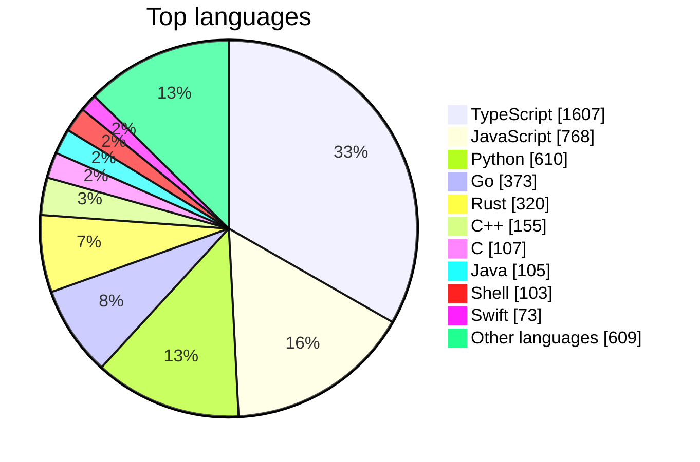
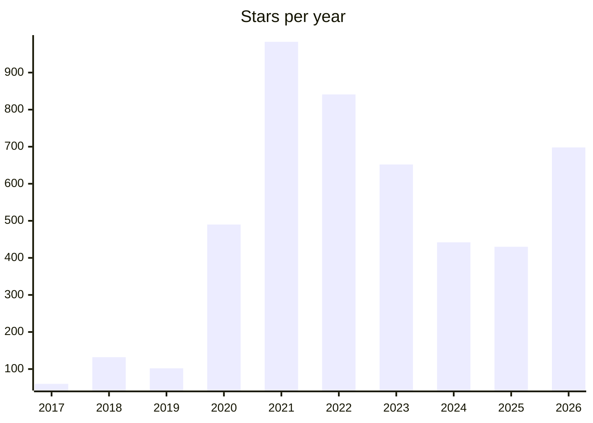

# Awesome Stars

> My GitHub stars, sorted and rebuilt every day by [starsmith](https://github.com/maxgfr/starsmith). Want the same for your stars? It takes one GitHub Action.

 

## ✨ Digest

Agents dominate this month's stars. **Agent protocols and frontends** lead, with A2A and AG-UI bringing agents into apps, while **coding-agent tooling** gets practical: claude-swap rotates accounts, TokenEconomizer controls costs, and free-claude-code stretches free tokens. Many projects also favor **local-first native apps**, like hex for offline dictation.

Elsewhere, OCR keeps rising with chandra and GLM-OCR, and trading agents like Vibe-Trading show AI spreading into finance.

<sub>Written by AI from the 81 repositories starred in the last 30 days.</sub>

## 🆕 Recently starred

- `2026-11-12` [GoogleChrome/modern-web-guidance](https://github.com/GoogleChrome/modern-web-guidance) — Guidance on current web development best practices, provided for use by coding agents.
- `2026-11-10` [ag-ui-protocol/ag-ui](https://github.com/ag-ui-protocol/ag-ui) — Protocol for connecting AI agents to frontend applications, covering agent-user interaction.
- `2026-11-10` [a2aproject/A2A](https://github.com/a2aproject/A2A) — Open protocol for communication and interoperability between opaque agentic applications.
- `2026-11-10` [open-slide/open-slide](https://github.com/open-slide/open-slide) — Slide framework designed for AI agents to build presentations, built with React.
- `2026-11-10` [milind-soni/OpenMausBot](https://github.com/milind-soni/OpenMausBot) — Open-source alternative to Grok Bot, with a virtual machine that bots can use for computer tasks.
- `2026-11-09` [DrWhax/unfairplay](https://github.com/DrWhax/unfairplay) — Tool for decrypting iOS IPA files on macOS.
- `2026-11-09` [mflux-community/mflux](https://github.com/mflux-community/mflux) — Apple MLX implementations of image and video generation models such as FLUX, for Apple silicon.
- `2026-11-09` [ciromattia/kcc](https://github.com/ciromattia/kcc) — Converter that turns comic and manga archives into ebook formats for Kindle and other e-readers.
- `2026-11-08` [liabru/matter-js](https://github.com/liabru/matter-js) — 2D rigid body physics engine for the web, for use in JavaScript and canvas applications.
- `2026-11-08` [jhlywa/chess.js](https://github.com/jhlywa/chess.js) — TypeScript library for chess move generation, validation, and check, checkmate, and draw detection.
- `2026-11-08` [anomalyco/rune](https://github.com/anomalyco/rune) — Native user interface framework written in Rust.
- `2026-11-07` [anomalyco/hex](https://github.com/anomalyco/hex) — Local voice dictation app for macOS, Windows, and Linux that runs speech recognition on-device.
- `2026-11-06` [unjs/uqr](https://github.com/unjs/uqr) — Universal QR code generator for any JavaScript runtime, with ANSI, Unicode, and SVG output.
- `2026-11-06` [matomo-org/plugin-McpServer](https://github.com/matomo-org/plugin-McpServer)
- `2026-11-06` [Tencent/WeKnora](https://github.com/Tencent/WeKnora) — LLM platform that turns documents into queryable RAG, reasoning agents, and self-maintaining wikis.

## 📊 Stats

**4830** repositories · **76** languages · **51** archived · starred since 2017-02-02





## Contents

- [AI and Machine Learning (233)](stars/ai-and-machine-learning.md)
- [Audio and Video Processing (119)](stars/audio-and-video-processing.md)
- [Awesome Lists and Learning Resources (169)](stars/awesome-lists-and-learning-resources.md)
- [Backend Frameworks and Servers (212)](stars/backend-frameworks-and-servers.md)
- [Browser Extensions and Scripts (74)](stars/browser-extensions-and-scripts.md)
- [Cloud and Kubernetes (156)](stars/cloud-and-kubernetes.md)
- [Cryptography and Blockchain (152)](stars/cryptography-and-blockchain.md)
- [Databases and Data Tools (248)](stars/databases-and-data-tools.md)
- [Desktop and Mobile Apps (229)](stars/desktop-and-mobile-apps.md)
- [Developer Tools and Editors (325)](stars/developer-tools-and-editors.md)
- [DevOps and Infrastructure (261)](stars/devops-and-infrastructure.md)
- [Documentation and Knowledge Tools (143)](stars/documentation-and-knowledge-tools.md)
- [Frontend UI Libraries (544)](stars/frontend-ui-libraries.md)
- [Image and Graphics Processing (81)](stars/image-and-graphics-processing.md)
- [JavaScript and TypeScript Tooling (526)](stars/javascript-and-typescript-tooling.md)
- [LLM Agents and AI Assistants (327)](stars/llm-agents-and-ai-assistants.md)
- [Mac Utilities (66)](stars/mac-utilities.md)
- [Networking and Wireless (104)](stars/networking-and-wireless.md)
- [Programming Languages and Compilers (48)](stars/programming-languages-and-compilers.md)
- [Security and Penetration Testing (239)](stars/security-and-penetration-testing.md)
- [Systems Programming in Go and Rust (41)](stars/systems-programming-in-go-and-rust.md)
- [Testing and Automation (110)](stars/testing-and-automation.md)
- [Others (423)](stars/others.md)

## AI and Machine Learning

| Name | Description | Author | Stars |
|---|---|---|---:|
| [tensorflow](https://github.com/tensorflow/tensorflow) | An Open Source Machine Learning Framework for Everyone | tensorflow | 202k |
| [ollama](https://github.com/ollama/ollama) | Tool for running open large language models such as DeepSeek, Gemma, GLM, and Qwen locally. | ollama | 187k |
| [transformers](https://github.com/huggingface/transformers) | 🤗 Transformers: the model-definition framework for state-of-the-art machine learning models in text, vision, audio, and multimodal models, for both inference and training. | huggingface | 169k |
| [ComfyUI](https://github.com/Comfy-Org/ComfyUI) | Node-based graph interface and backend for running diffusion models locally. | Comfy-Org | 146k |
| [llama.cpp](https://github.com/ggml-org/llama.cpp) | C/C++ inference of large language models using the ggml tensor library. | ggml-org | 134k |

**[→ All 233 repositories](stars/ai-and-machine-learning.md)**

## Audio and Video Processing

| Name | Description | Author | Stars |
|---|---|---|---:|
| [yt-dlp](https://github.com/yt-dlp/yt-dlp) | A feature-rich command-line audio/video downloader | yt-dlp | 207k |
| [scrcpy](https://github.com/Genymobile/scrcpy) | Display and control your Android device | Genymobile | 155k |
| [iptv](https://github.com/iptv-org/iptv) | Collection of publicly available IPTV channel playlists from around the world. | iptv-org | 144k |
| [youtube-dl](https://github.com/ytdl-org/youtube-dl) | Command-line program to download videos from YouTube.com and other video sites | ytdl-org | 142k |
| [VoiceStudio](https://github.com/debpalash/VoiceStudio) | Local voice cloning, dubbing, dictation, transcription, and audiobook creation in 646 languages. | debpalash | 109k |

**[→ All 119 repositories](stars/audio-and-video-processing.md)**

## Awesome Lists and Learning Resources

| Name | Description | Author | Stars |
|---|---|---|---:|
| [build-your-own-x](https://github.com/codecrafters-io/build-your-own-x) | Curated list of tutorials for recreating well-known technologies from scratch. | codecrafters-io | 562k |
| [awesome](https://github.com/sindresorhus/awesome) | 😎 Awesome lists about all kinds of interesting topics \[NOTE: Pull requests are temporarily disabled until I have a chance to catch up with the existing ones\] | sindresorhus | 536k |
| [public-apis](https://github.com/public-apis/public-apis) | A collective list of free APIs | public-apis | 498k |
| [free-programming-books](https://github.com/EbookFoundation/free-programming-books) | :books: Freely available programming books | EbookFoundation | 401k |
| [system-design-primer](https://github.com/donnemartin/system-design-primer) | Learn how to design large-scale systems. Prep for the system design interview. Includes Anki flashcards. | donnemartin | 378k |

**[→ All 169 repositories](stars/awesome-lists-and-learning-resources.md)**

## Backend Frameworks and Servers

| Name | Description | Author | Stars |
|---|---|---|---:|
| [node](https://github.com/nodejs/node) | Node.js JavaScript runtime ✨🐢🚀✨ | nodejs | 123k |
| [fastapi](https://github.com/fastapi/fastapi) | FastAPI framework, high performance, easy to learn, fast to code, ready for production | fastapi | 105k |
| [gin](https://github.com/gin-gonic/gin) | Gin is a high-performance HTTP web framework written in Go. It provides a Martini-like API but with significantly better performance—up to 40 times faster—thanks to httprouter. Gin is designed for building REST APIs, web applications, and microservices. | gin-gonic | 89.5k |
| [caddy](https://github.com/caddyserver/caddy) | Fast and extensible multi-platform HTTP/1-2-3 web server with automatic HTTPS | caddyserver | 79k |
| [nest](https://github.com/nestjs/nest) | A progressive TypeScript framework for Node.js backends: from a small API in one file to efficient, scalable, enterprise-grade systems 🚀 | nestjs | 77.1k |

**[→ All 212 repositories](stars/backend-frameworks-and-servers.md)**

## Browser Extensions and Scripts

| Name | Description | Author | Stars |
|---|---|---|---:|
| [uBlock](https://github.com/gorhill/uBlock) | uBlock Origin - An efficient blocker for Chromium and Firefox. Fast and lean. | gorhill | 69.3k |
| [markdown-here](https://github.com/adam-p/markdown-here) | Google Chrome, Firefox, and Thunderbird extension that lets you write email in Markdown and render it before sending. | adam-p | 60.3k |
| [obscura](https://github.com/h4ckf0r0day/obscura) | Headless browser built for AI agents and web scraping, with anti-detection features. | h4ckf0r0day | 33.2k |
| [refined-github](https://github.com/refined-github/refined-github) | :octocat: Browser extension that simplifies the GitHub interface and adds useful features | refined-github | 32.5k |
| [vimium](https://github.com/philc/vimium) | The hacker's browser. | philc | 27.1k |

**[→ All 74 repositories](stars/browser-extensions-and-scripts.md)**

## Cloud and Kubernetes

| Name | Description | Author | Stars |
|---|---|---|---:|
| [moby](https://github.com/moby/moby) | The Moby Project - a collaborative project for the container ecosystem to assemble container-based systems | moby | 72.3k |
| [rclone](https://github.com/rclone/rclone) | Command-line tool for syncing and managing files across many cloud storage providers, like rsync. | rclone | 61k |
| [kubernetes-the-hard-way](https://github.com/kelseyhightower/kubernetes-the-hard-way) | Bootstrap Kubernetes the hard way. No scripts. | kelseyhightower | 50.7k |
| [serverless](https://github.com/serverless/serverless) | ⚡ Serverless Framework – Effortlessly build apps that auto-scale, incur zero costs when idle, and require minimal maintenance using AWS Lambda and other managed cloud services. | serverless | 46.9k |
| [firecracker](https://github.com/firecracker-microvm/firecracker) | Secure and fast microVMs for serverless computing. | firecracker-microvm | 38k |

**[→ All 156 repositories](stars/cloud-and-kubernetes.md)**

## Cryptography and Blockchain

| Name | Description | Author | Stars |
|---|---|---|---:|
| [freqtrade](https://github.com/freqtrade/freqtrade) | Free, open source crypto trading bot | freqtrade | 56.8k |
| [acme.sh](https://github.com/acmesh-official/acme.sh) | A pure Unix shell script ACME client for SSL / TLS certificate automation | acmesh-official | 48k |
| [ccxt](https://github.com/ccxt/ccxt) | A unified trading API with more than 100 crypto exchanges and prediction markets in JavaScript / TypeScript / Python / C# / PHP / Go / Java / Rust | ccxt | 44.9k |
| [certbot](https://github.com/certbot/certbot) | Certbot is EFF's tool to obtain certs from Let's Encrypt and (optionally) auto-enable HTTPS on your server. It can also act as a client for any other CA that uses the ACME protocol. | certbot | 33.3k |
| [openssl](https://github.com/openssl/openssl) | General purpose TLS and crypto library | openssl | 31.4k |

**[→ All 152 repositories](stars/cryptography-and-blockchain.md)**

## Databases and Data Tools

| Name | Description | Author | Stars |
|---|---|---|---:|
| [supabase](https://github.com/supabase/supabase) | The Postgres development platform. Supabase gives you a dedicated Postgres database to build your web, mobile, and AI applications. | supabase | 115k |
| [elasticsearch](https://github.com/elastic/elasticsearch) | Free and Open Source, Distributed, RESTful Search Engine | elastic | 78.7k |
| [redis](https://github.com/redis/redis) | For developers, who are building real-time data-driven applications, Redis is the preferred, fastest, and most feature-rich cache, data structure server, and document and vector query engine. | redis | 77.5k |
| [nocodb](https://github.com/nocodb/nocodb) | 🔥 🔥 🔥 A Free &amp; Self-hostable Airtable Alternative | nocodb | 65.5k |
| [pathway](https://github.com/pathwaycom/pathway) | Python framework for ETL, stream processing, real-time analytics, LLM pipelines, and RAG. | pathwaycom | 62k |

**[→ All 248 repositories](stars/databases-and-data-tools.md)**

## Desktop and Mobile Apps

| Name | Description | Author | Stars |
|---|---|---|---:|
| [flutter](https://github.com/flutter/flutter) | Flutter makes it easy and fast to build beautiful apps for mobile and beyond | flutter | 181k |
| [PowerToys](https://github.com/microsoft/PowerToys) | Microsoft PowerToys is a collection of utilities that supercharge productivity and customization on Windows | microsoft | 141k |
| [rustdesk](https://github.com/rustdesk/rustdesk) | Open-source remote desktop application for self-hosting, as an alternative to TeamViewer. | rustdesk | 129k |
| [react-native](https://github.com/react/react-native) | A framework for building native applications using React | react | 127k |
| [electron](https://github.com/electron/electron) | :electron: Build cross-platform desktop apps with JavaScript, HTML, and CSS | electron | 124k |

**[→ All 229 repositories](stars/desktop-and-mobile-apps.md)**

## Developer Tools and Editors

| Name | Description | Author | Stars |
|---|---|---|---:|
| [n8n](https://github.com/n8n-io/n8n) | Fair-code workflow automation platform with native AI capabilities. Combine visual building with custom code, self-host or cloud, 400+ integrations. | n8n-io | 210k |
| [vscode](https://github.com/microsoft/vscode) | Visual Studio Code | microsoft | 195k |
| [gitignore](https://github.com/github/gitignore) | A collection of useful .gitignore templates | github | 176k |
| [spec-kit](https://github.com/github/spec-kit) | Toolkit for spec-driven development and other processes with AI coding assistants. | github | 149k |
| [terminal](https://github.com/microsoft/terminal) | The new Windows Terminal and the original Windows console host, all in the same place! | microsoft | 105k |

**[→ All 325 repositories](stars/developer-tools-and-editors.md)**

## DevOps and Infrastructure

| Name | Description | Author | Stars |
|---|---|---|---:|
| [uptime-kuma](https://github.com/louislam/uptime-kuma) | A fancy self-hosted monitoring tool | louislam | 93.5k |
| [netdata](https://github.com/netdata/netdata) | The fastest path to AI-powered full stack observability, even for lean teams. | netdata | 81.4k |
| [grafana](https://github.com/grafana/grafana) | The open and composable observability and data visualization platform. Visualize metrics, logs, and traces from multiple sources like Prometheus, Loki, Elasticsearch, InfluxDB, Postgres and many more. | grafana | 77.9k |
| [act](https://github.com/nektos/act) | Run your GitHub Actions locally 🚀 | nektos | 72.7k |
| [ansible](https://github.com/ansible/ansible) | Ansible is a radically simple IT automation platform that makes your applications and systems easier to deploy and maintain. Automate everything from code deployment to network configuration to cloud management, in a language that approaches plain English, using SSH, with no agents to install on remote systems. https://docs.ansible.com. | ansible | 71.5k |

**[→ All 261 repositories](stars/devops-and-infrastructure.md)**

## Documentation and Knowledge Tools

| Name | Description | Author | Stars |
|---|---|---|---:|
| [markitdown](https://github.com/microsoft/markitdown) | Python tool that converts files and Office documents to Markdown. | microsoft | 195k |
| [javascript](https://github.com/airbnb/javascript) | JavaScript Style Guide | airbnb | 148k |
| [mermaid](https://github.com/mermaid-js/mermaid) | Generation of diagrams like flowcharts or sequence diagrams from text in a similar manner as markdown | mermaid-js | 91.1k |
| [hugo](https://github.com/gohugoio/hugo) | The world’s fastest framework for building websites. | gohugoio | 90.5k |
| [AppFlowy](https://github.com/AppFlowy-IO/AppFlowy) | Bring projects, wikis, and teams together with AI. AppFlowy is the AI collaborative workspace where you achieve more without losing control of your data. The leading open source Notion alternative. | AppFlowy-IO | 78.8k |

**[→ All 143 repositories](stars/documentation-and-knowledge-tools.md)**

## Frontend UI Libraries

| Name | Description | Author | Stars |
|---|---|---|---:|
| [react](https://github.com/react/react) | The library for web and native user interfaces. | react | 253k |
| [next.js](https://github.com/vercel/next.js) | The React Framework | vercel | 143k |
| [excalidraw](https://github.com/excalidraw/excalidraw) | Virtual whiteboard for sketching hand-drawn like diagrams | excalidraw | 136k |
| [ui](https://github.com/shadcn-ui/ui) | Copyable, accessible UI components you customize and extend to build your own component library. | shadcn-ui | 128k |
| [d3](https://github.com/d3/d3) | Bring data to life with SVG, Canvas and HTML. :bar_chart::chart_with_upwards_trend::tada: | d3 | 114k |

**[→ All 544 repositories](stars/frontend-ui-libraries.md)**

## Image and Graphics Processing

| Name | Description | Author | Stars |
|---|---|---|---:|
| [immich](https://github.com/immich-app/immich) | Self-hosted photo and video management solution with mobile apps and automatic backup. | immich-app | 119k |
| [three.js](https://github.com/mrdoob/three.js) | JavaScript 3D Library. | mrdoob | 118k |
| [opencv](https://github.com/opencv/opencv) | Open source computer vision library with algorithms for image processing and deep learning. | opencv | 91.5k |
| [FiraCode](https://github.com/tonsky/FiraCode) | Free monospaced font with programming ligatures | tonsky | 82.2k |
| [photocraft](https://github.com/storytold/photocraft) | Open-source photo editor written from scratch in pure Rust. | storytold | 78.9k |

**[→ All 81 repositories](stars/image-and-graphics-processing.md)**

## JavaScript and TypeScript Tooling

| Name | Description | Author | Stars |
|---|---|---|---:|
| [axios](https://github.com/axios/axios) | Promise based HTTP client for the browser and node.js | axios | 109k |
| [deno](https://github.com/denoland/deno) | A modern runtime for JavaScript and TypeScript. | denoland | 109k |
| [bun](https://github.com/oven-sh/bun) | Incredibly fast JavaScript runtime, bundler, test runner, and package manager – all in one | oven-sh | 96.7k |
| [vite](https://github.com/vitejs/vite) | Next generation frontend tooling. It's fast! | vitejs | 83.9k |
| [webpack](https://github.com/webpack/webpack) | A bundler for javascript and friends. Packs many modules into a few bundled assets. Code Splitting allows for loading parts of the application on demand. Through "loaders", modules can be CommonJs, AMD, ES6 modules, CSS, Images, JSON, Coffeescript, LESS, ... and your custom stuff. | webpack | 66k |

**[→ All 526 repositories](stars/javascript-and-typescript-tooling.md)**

## LLM Agents and AI Assistants

| Name | Description | Author | Stars |
|---|---|---|---:|
| [openclaw](https://github.com/openclaw/openclaw) | Personal AI assistant that carries out tasks on any operating system and messaging platform. | openclaw | 394k |
| [skills](https://github.com/mattpocock/skills) | Collection of agent skills for software engineers, taken from the author's .agents directory. | mattpocock | 323k |
| [superpowers](https://github.com/obra/superpowers) | Skills framework and software development methodology for AI coding agents. | obra | 317k |
| [ECC](https://github.com/affaan-m/ECC) | Agent harness of skills, memory and security tools for Claude Code, Codex, Cursor and others. | affaan-m | 302k |
| [deepseek-harness](https://github.com/deepseek-ai/deepseek-harness) | Plugin-based agent harness for DeepSeek, built on Cordis, where everything is a plugin. | deepseek-ai | 279k |

**[→ All 327 repositories](stars/llm-agents-and-ai-assistants.md)**

## Mac Utilities

| Name | Description | Author | Stars |
|---|---|---|---:|
| [awesome-mac](https://github.com/jaywcjlove/awesome-mac) |  This project is dedicated to collecting high-quality macOS software and organizing them systematically by different categories for easy search and use. | jaywcjlove | 118k |
| [Mole](https://github.com/tw93/Mole) | Open-source Mac and PC cleaner CLI that frees disk space and analyzes storage use. | tw93 | 74.7k |
| [open-source-mac-os-apps](https://github.com/serhii-londar/open-source-mac-os-apps) | 🚀 Awesome list of open source applications for macOS. https://t.me/s/opensourcemacosapps | serhii-londar | 51.3k |
| [brew](https://github.com/Homebrew/brew) | 🍺 The Package Manager for Everywhere | Homebrew | 50.3k |
| [stats](https://github.com/exelban/stats) | macOS system monitor showing CPU, memory, disk, network, battery and fan stats in the menu bar. | exelban | 43.3k |

**[→ All 66 repositories](stars/mac-utilities.md)**

## Networking and Wireless

| Name | Description | Author | Stars |
|---|---|---|---:|
| [frp](https://github.com/fatedier/frp) | A fast reverse proxy to help you expose a local server behind a NAT or firewall to the internet. | fatedier | 111k |
| [syncthing](https://github.com/syncthing/syncthing) | Open Source Continuous File Synchronization | syncthing | 90.4k |
| [pi-hole](https://github.com/pi-hole/pi-hole) | A black hole for Internet advertisements | pi-hole | 61.9k |
| [copyparty](https://github.com/9001/copyparty) | Single-file portable file server with resumable uploads, deduplication, WebDAV, SFTP, FTP, and media indexing. | 9001 | 47.3k |
| [okhttp](https://github.com/lysine-dev/okhttp) | A meticulous HTTP client for the JVM, Android, and GraalVM. | lysine-dev | 47.1k |

**[→ All 104 repositories](stars/networking-and-wireless.md)**

## Programming Languages and Compilers

| Name | Description | Author | Stars |
|---|---|---|---:|
| [go](https://github.com/golang/go) | The Go programming language | golang | 140k |
| [rust](https://github.com/rust-lang/rust) | Empowering everyone to build reliable and efficient software. | rust-lang | 122k |
| [TypeScript](https://github.com/microsoft/TypeScript) | TypeScript is a superset of JavaScript that compiles to clean JavaScript output. | microsoft | 112k |
| [java-design-patterns](https://github.com/iluwatar/java-design-patterns) | Design patterns implemented in Java | iluwatar | 94.9k |
| [cpython](https://github.com/python/cpython) | The Python programming language | python | 78.2k |

**[→ All 48 repositories](stars/programming-languages-and-compilers.md)**

## Security and Penetration Testing

| Name | Description | Author | Stars |
|---|---|---|---:|
| [rea](https://github.com/morluto/rea) | Agent-based tool for reverse engineering applications, from app behavior down to native binaries. | morluto | 454k |
| [Microsoft-Activation-Scripts](https://github.com/massgravel/Microsoft-Activation-Scripts) | Open-source script for activating Windows and Office using HWID, Ohook, TSforge and KMS methods. | massgravel | 199k |
| [sherlock](https://github.com/sherlock-project/sherlock) | Hunt down social media accounts by username across social networks | sherlock-project | 110k |
| [ghidra](https://github.com/NationalSecurityAgency/ghidra) | Ghidra is a software reverse engineering (SRE) framework | NationalSecurityAgency | 99.7k |
| [PayloadsAllTheThings](https://github.com/swisskyrepo/PayloadsAllTheThings) | A list of useful payloads and bypass for Web Application Security and Pentest/CTF | swisskyrepo | 82.6k |

**[→ All 239 repositories](stars/security-and-penetration-testing.md)**

## Systems Programming in Go and Rust

| Name | Description | Author | Stars |
|---|---|---|---:|
| [croc](https://github.com/schollz/croc) | Command-line tool for securely sending files and folders between computers with peer-to-peer transfer. | schollz | 40.9k |
| [tokio](https://github.com/tokio-rs/tokio) | Asynchronous runtime for Rust, providing I/O, networking, scheduling, and timers. | tokio-rs | 33.7k |
| [iced](https://github.com/iced-rs/iced) | A cross-platform GUI library for Rust, inspired by Elm | iced-rs | 32k |
| [nautilus_trader](https://github.com/nautechsystems/nautilus_trader) | Rust-native algorithmic trading engine with a deterministic event-driven architecture for production use. | nautechsystems | 31.5k |
| [zstd](https://github.com/meta/zstd) | Fast real-time lossless compression algorithm and reference library. | meta | 28.2k |

**[→ All 41 repositories](stars/systems-programming-in-go-and-rust.md)**

## Testing and Automation

| Name | Description | Author | Stars |
|---|---|---|---:|
| [Scrapling](https://github.com/D4Vinci/Scrapling) | Web scraping framework for everything from single requests to full-scale crawls. | D4Vinci | 102k |
| [playwright](https://github.com/microsoft/playwright) | Playwright is a framework for Web Testing and Automation. It allows testing Chromium, Firefox and WebKit with a single API. | microsoft | 100k |
| [puppeteer](https://github.com/puppeteer/puppeteer) | JavaScript API for Chrome and Firefox | puppeteer | 95.8k |
| [cypress](https://github.com/cypress-io/cypress) | Fast, easy and reliable testing for anything that runs in a browser. | cypress-io | 51k |
| [jest](https://github.com/jestjs/jest) | Delightful JavaScript Testing. | jestjs | 45.5k |

**[→ All 110 repositories](stars/testing-and-automation.md)**

## Others

| Name | Description | Author | Stars |
|---|---|---|---:|
| [linux](https://github.com/torvalds/linux) | Linux kernel source tree | torvalds | 255k |
| [ohmyzsh](https://github.com/ohmyzsh/ohmyzsh) | 🙃 A delightful community-driven (with 2,500+ contributors) framework for managing your zsh configuration. Includes 300+ optional plugins (rails, git, macOS, hub, docker, homebrew, node, php, python, etc), 140+ themes to spice up your morning, and an auto-update tool that makes it easy to keep up with the latest updates from the community. | ohmyzsh | 191k |
| [bootstrap](https://github.com/twbs/bootstrap) | The most popular HTML, CSS, and JavaScript framework for developing responsive, mobile first projects on the web. | twbs | 175k |
| [kubernetes](https://github.com/kubernetes/kubernetes) | Production-Grade Container Scheduling and Management | kubernetes | 129k |
| [godot](https://github.com/godotengine/godot) | Godot Engine – Multi-platform 2D and 3D game engine | godotengine | 120k |

**[→ All 423 repositories](stars/others.md)**

**Legend:** 🗄️ archived · 🆕 starred in the last 30 days

## ⭐ Make your own

This list is built by [starsmith](https://github.com/maxgfr/starsmith). To get yours, add this
workflow to any repository, then run it once from the Actions tab:

```yaml
# .github/workflows/stars.yml
name: Update stars
on:
  schedule:
    - cron: "30 18 * * *"
  workflow_dispatch:
permissions:
  contents: write
jobs:
  stars:
    runs-on: ubuntu-latest
    steps:
      - uses: actions/checkout@v7
      - uses: maxgfr/starsmith@v1
```

For AI categories, descriptions and a digest, add `group-by: ai-category`, `ai: true`,
`ai-provider` and an `ai-api-key` secret. Every option is in the
[starsmith README](https://github.com/maxgfr/starsmith#options).

<sub>Generated by [starsmith](https://github.com/maxgfr/starsmith) · 2026-11-12</sub>
